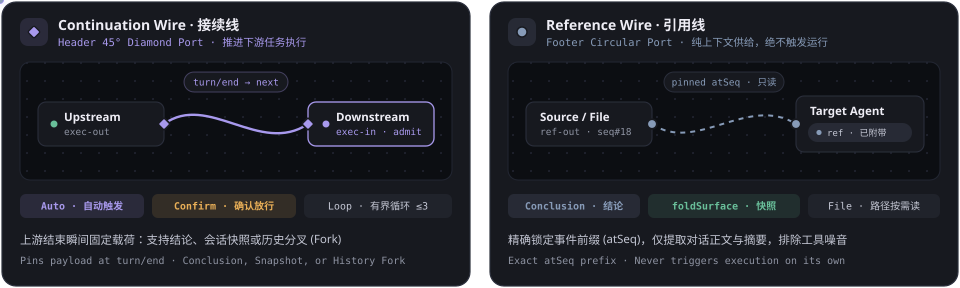
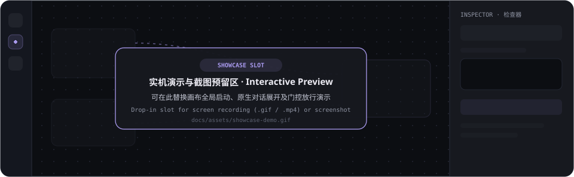
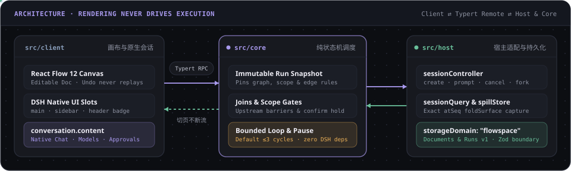

<div align="center">

<picture>
  <source media="(prefers-color-scheme: dark)" srcset="./docs/assets/hero-dark.svg" />
  <source media="(prefers-color-scheme: light)" srcset="./docs/assets/hero-light.svg" />
  
</picture>

<br />

<p>
  <a href="./docs/capabilities.md"><picture><source media="(prefers-color-scheme: dark)" srcset="./docs/assets/badge-dsh-dark.svg" /><source media="(prefers-color-scheme: light)" srcset="./docs/assets/badge-dsh-light.svg" /></picture></a>&nbsp;
  <a href="#quick-start"><picture><source media="(prefers-color-scheme: dark)" srcset="./docs/assets/badge-node-dark.svg" /><source media="(prefers-color-scheme: light)" srcset="./docs/assets/badge-node-light.svg" />= 24.9" src="./docs/assets/badge-node-dark.svg" height="24" /></picture></a>&nbsp;
  <a href="#architecture"><picture><source media="(prefers-color-scheme: dark)" srcset="./docs/assets/badge-scheduler-dark.svg" /><source media="(prefers-color-scheme: light)" srcset="./docs/assets/badge-scheduler-light.svg" /></picture></a>&nbsp;
  <a href="./packages/flowspace/LICENSE"><picture><source media="(prefers-color-scheme: dark)" srcset="./docs/assets/badge-license-dark.svg" /><source media="(prefers-color-scheme: light)" srcset="./docs/assets/badge-license-light.svg" /></picture></a>
</p>

<p>
  <strong>Persistent Agent Infinite Canvas &amp; Host-Owned Visual Workflows for DeepSeek Harness <code>0.2.2-rc.3</code></strong><br />
  <sub>Real multi-turn DSH Sessions · Reference wires supply context · Continuation wires drive execution · Page-switch safe</sub>
</p>

<p>
  <a href="./README.md">简体中文</a> · <strong>English</strong>
  &nbsp;&nbsp;｜&nbsp;&nbsp;
  <a href="#core-thesis">Core Thesis</a> ·
  <a href="#port-semantics--interaction">Port Semantics</a> ·
  <a href="#interactive-showcase">Showcase</a> ·
  <a href="#quick-start">Quick Start</a> ·
  <a href="#architecture">Architecture</a> ·
  <a href="#verification--roadmap">Roadmap</a>
</p>

</div>

<picture>
  <source media="(prefers-color-scheme: dark)" srcset="./docs/assets/divider-dark.svg" />
  <source media="(prefers-color-scheme: light)" srcset="./docs/assets/divider-light.svg" />
  
</picture>

## Core Thesis

> [!NOTE]
> **Documentation Status**: This README sets up the visual framework, SVG diagrams, and verified workflow commands. Sections marked with `TODO` are structured placeholders reserved for upcoming walkthroughs, recordings, and best-practice recipes.

<table>
<tr>
<td width="33%" valign="top">

### ◈ Persistent Native Sessions
Every Agent card binds to an ordinary, long-lived **DSH Session** rather than a disposable job wrapper. Expanding any node embeds DSH's native `conversation.content` UI—preserving model selection, permissions, attachments, tool output, and interactive approvals.

<sub>`TODO` · Add real-world multi-turn session + canvas co-editing examples</sub>

</td>
<td width="33%" valign="top">

### ◆ Decoupled Context &amp; Execution
Context delivery and workflow dispatch are strictly separated: **circular footer ports** inject read-only context without ever triggering runs, while **45° diamond header ports** advance serial, parallel, join, and bounded-loop workflows.

<sub>`TODO` · Add annotated multi-agent workflow pattern recipes</sub>

</td>
<td width="33%" valign="top">

### ● Host-Owned Orchestration
The workflow scheduler lives entirely in the **DSH Host**. Navigating away from the FlowSpace panel never interrupts active runs, and canvas undo/redo history is cleanly isolated from runtime execution so Undo never replays a prompt.

<sub>`TODO` · Add operational notes on background runs and restart recovery</sub>

</td>
</tr>
</table>

<picture>
  <source media="(prefers-color-scheme: dark)" srcset="./docs/assets/divider-dark.svg" />
  <source media="(prefers-color-scheme: light)" srcset="./docs/assets/divider-light.svg" />
  
</picture>

## Port Semantics &amp; Interaction

<p align="center">
  <picture>
    <source media="(prefers-color-scheme: dark)" srcset="./docs/assets/ports-dark.svg" />
    <source media="(prefers-color-scheme: light)" srcset="./docs/assets/ports-light.svg" />
    
  </picture>
</p>

### Primitives at a Glance

| Dimension | Options / Kinds | Contract &amp; Runtime Behavior |
| :--- | :--- | :--- |
| **Canvas Nodes** | `Agent` · `File` · `Display` · `Note` · `Group` | Double-click canvas to create an Agent or attach an existing Session; supports two-level groups, workspace file references, and pinned output cards |
| **Continuation (`◆`)** | `Auto` · `Confirm` · `Manual` | Connects 45° diamond header ports; supports multi-upstream Join barriers and bounded loops (up to `3` cycles by default) |
| **Reference (`●`)** | `Conclusion` · `Session Snapshot` · `File Path` | Connects circular footer ports; captures user/assistant text &amp; compaction checkpoints at an exact `atSeq` prefix (excluding reasoning &amp; tool noise) |
| **History Fork** | Unstarted draft nodes only | Forks a native DSH Session at an exact event boundary while retaining the original workspace; queued waits never mutate captured upstream payloads |

<details>
<summary><strong>Expand: Run Controls, Native Chat Sync &amp; Storage Rules</strong></summary>

<br />

1. **Launch Checklist &amp; Scope Gates**: Global launch previews starting nodes so you can deselect unwanted entry points; multi-select or group runs automatically hold at scope boundaries until explicitly released.
2. **Native Chat Integration**: Prompting a bound Session from DSH's native chat view triggers downstream FlowSpace continuations by default (configurable globally in canvas settings or per node in the inspector). A header action badge shows live continuation status and jumps back to the canvas node.
3. **Granular Run Controls**:
   - **Pause**: Suspends future dispatch while allowing already-admitted turns to settle cleanly.
   - **Stop Agent**: Cancels the active turn on a specific node.
   - **Cancel Run**: Cancels only the tasks owned by that workflow run. After a Host shutdown or plugin reload, interrupted runs require explicit human continuation and never auto-replay.
4. **Drafts &amp; Persistence**: Task presets feed automated continuations; input drafts stage the next manual send. Canvas documents persist in the `flowspace` DSH storage domain (`v1`) with JSON import/export. Deleting a canvas node never deletes its underlying DSH Session.

> `TODO`: Add an annotated Inspector configuration reference table here.

</details>

<picture>
  <source media="(prefers-color-scheme: dark)" srcset="./docs/assets/divider-dark.svg" />
  <source media="(prefers-color-scheme: light)" srcset="./docs/assets/divider-light.svg" />
  
</picture>

## Interactive Showcase

<p align="center">
  <picture>
    <source media="(prefers-color-scheme: dark)" srcset="./docs/assets/showcase-placeholder-dark.svg" />
    <source media="(prefers-color-scheme: light)" srcset="./docs/assets/showcase-placeholder-light.svg" />
    
  </picture>
</p>

<table>
<tr>
<td width="33%" valign="top">

**01 · Canvas Layout &amp; Launch Checklist**  
<sub>`[Media Slot]` · Multi-node topology, two-level group folding, and pre-flight entry selection.</sub>

</td>
<td width="33%" valign="top">

**02 · Embedded Native Chat &amp; Approvals**  
<sub>`[Media Slot]` · Expanded DSH conversation card, interactive tool approvals, and context capsules.</sub>

</td>
<td width="33%" valign="top">

**03 · Parallel Join &amp; Confirmation Gate**  
<sub>`[Media Slot]` · Concurrent upstream execution settling into a gated downstream release.</sub>

</td>
</tr>
</table>

<picture>
  <source media="(prefers-color-scheme: dark)" srcset="./docs/assets/divider-dark.svg" />
  <source media="(prefers-color-scheme: light)" srcset="./docs/assets/divider-light.svg" />
  
</picture>

## Quick Start

> **Prerequisites**: Node.js `>= 24.9.0`, `pnpm@11`, targeting `@deepseek-ai/dsh@0.2.2-rc.3`.

### Option A: Install into an Existing DSH Profile

Update DSH to `0.2.2-rc.3`, pack the plugin tarball, and run the profile-safe installer:

```bash
pnpm pack:plugin
node scripts/install.mjs --profile web
```

- `scripts/install.mjs` backs up the target profile's `manifest`, `patch`, and `lockfile` before invoking the DSH CLI (replace `web` with any custom profile name) and preserves your existing model settings.
- Enable **FlowSpace** on the DSH Plugins page, then open it from the left sidebar.

<details>
<summary>Manual DSH CLI Install / Disable &amp; Uninstall Commands</summary>

```bash
# Manual install (back up your profile first)
dsh plugin --profile web add /absolute/path/to/dsh-flowspace-0.1.0.tgz

# Uninstall (existing DSH Sessions and stored canvas documents are preserved)
dsh plugin --profile web remove dsh-flowspace
```

- **Disable**: Toggle FlowSpace off on the DSH Plugins page to stop plugin-owned scheduling without removing data.

</details>

### Option B: Local Isolated Development

```bash
pnpm install
pnpm build
pnpm dev          # Default port 3190 (uses configured real models)
```

- **Profile Isolation**: `pnpm dev` launches against `.local/flowspace` as a dedicated `$DSH_HOME` (with `.local/flowspace/workspace` as its workspace), leaving your global DSH installation and daily `web` profile untouched. Configure models in that isolated profile or via environment variables—**never commit credentials to source**.
- **Deterministic Mock Model Fixture**:

```bash
pnpm dev:mock     # Default port 3191 (model name: FlowSpace integration fixture)
```

> `dev:mock` runs the full DSH session, queue, event, and storage stack against a deterministic model fixture prefixed with `【测试模型】`—ideal for zero-cost UI and scheduler iteration.

<details>
<summary><code>TODO</code> · Troubleshooting &amp; FAQ (Placeholder)</summary>

<br />

- **Q1: How do I export or share a canvas graph?** — _To be documented (JSON import/export in canvas settings)_
- **Q2: How are interrupted runs handled after restarting DSH?** — _To be documented (log inspection &amp; manual continuation)_

</details>

<picture>
  <source media="(prefers-color-scheme: dark)" srcset="./docs/assets/divider-dark.svg" />
  <source media="(prefers-color-scheme: light)" srcset="./docs/assets/divider-light.svg" />
  
</picture>

## Architecture

<p align="center">
  <picture>
    <source media="(prefers-color-scheme: dark)" srcset="./docs/assets/architecture-dark.svg" />
    <source media="(prefers-color-scheme: light)" srcset="./docs/assets/architecture-light.svg" />
    
  </picture>
</p>

| Module | Responsibility | Architectural Invariant |
| :--- | :--- | :--- |
| [`packages/flowspace/src/core`](./packages/flowspace/src/core) | Pure graph topology &amp; workflow state machine (serial/parallel, Join barriers, scope gates, bounded loops) | Zero DSH dependencies; deterministically unit-tested |
| [`packages/flowspace/src/host`](./packages/flowspace/src/host) | DSH `sessionController` adapter, exact `atSeq` reference capture, `flowspace` storage domain &amp; Typert Remote | Single input-validation boundary; pins run topology on launch |
| [`packages/flowspace/src/client`](./packages/flowspace/src/client) | React Flow canvas, DSH UI `slots` registration, and embedded `conversation.content` session cards | Rendering never drives execution; document edits never replay runs |

> [!IMPORTANT]
> **Build-Time Protocol Note**: The Typert `0.2.2-rc.3` code generator natively scans workspace-internal protocol declarations only. [`scripts/build.mjs`](./scripts/build.mjs) emits a build-only shim under `.local/build-tools` so published npm protocol declarations resolve cleanly—**neither the installed DSH host nor the runtime plugin applies any patches**.

<picture>
  <source media="(prefers-color-scheme: dark)" srcset="./docs/assets/divider-dark.svg" />
  <source media="(prefers-color-scheme: light)" srcset="./docs/assets/divider-light.svg" />
  
</picture>

## Verification &amp; Roadmap

### Verification Suite

```bash
pnpm check                            # Plugin build + Host/Client typecheck + scheduler unit tests
pnpm test:integration                 # Full rc.3 Host + deterministic fixture integration test
pnpm exec tsx scripts/real-smoke.ts   # Live-model smoke test: parallel -> join -> serial (consumes tokens)
```

> `real-smoke.ts` executes four short tasks inside a dedicated scratch workspace and writes its report to `artifacts/real-smoke.json`. Do not run integration scripts against your daily profile.

### Scope &amp; Roadmap

- [x] Single persistent infinite canvas, editable starter examples, and JSON import/export
- [x] Persistent DSH Session binding, embedded native conversation &amp; approvals, and native chat header badge
- [x] Diamond continuation wires (`Auto` / `Confirm` / bounded loops) &amp; circular reference wires (`Conclusion` / `foldSurface` snapshot / file path / history fork)
- [x] Basic two-level groups, bilingual UI (Chinese / English), and DSH dark/light theme sync
- [ ] `Roadmap` · Summary handoff &amp; template version synchronization
- [ ] `Roadmap` · Editable composite group ports &amp; richer floating windows
- [ ] `Roadmap` · Automatic Git worktree management, Team messaging &amp; multi-host collaboration
- [ ] `TODO` · _Add upcoming milestone details here_

### Further Reading

- **Visual &amp; Interaction Thesis**: [`docs/design.md`](./docs/design.md)
- **DSH `0.2.2-rc.3` Integration Notes**: [`docs/capabilities.md`](./docs/capabilities.md)
- **Verification Report**: [`docs/verification.md`](./docs/verification.md)

<picture>
  <source media="(prefers-color-scheme: dark)" srcset="./docs/assets/divider-dark.svg" />
  <source media="(prefers-color-scheme: light)" srcset="./docs/assets/divider-light.svg" />
  
</picture>

<div align="center">
  <sub>
    Released under the <a href="./packages/flowspace/LICENSE">MIT License</a> ·
    Third-party notices in <a href="./packages/flowspace/THIRD_PARTY_NOTICES.md">THIRD_PARTY_NOTICES.md</a><br />
    Built for DeepSeek Harness <code>0.2.2-rc.3</code>
  </sub>
</div>
