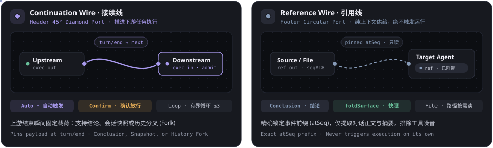
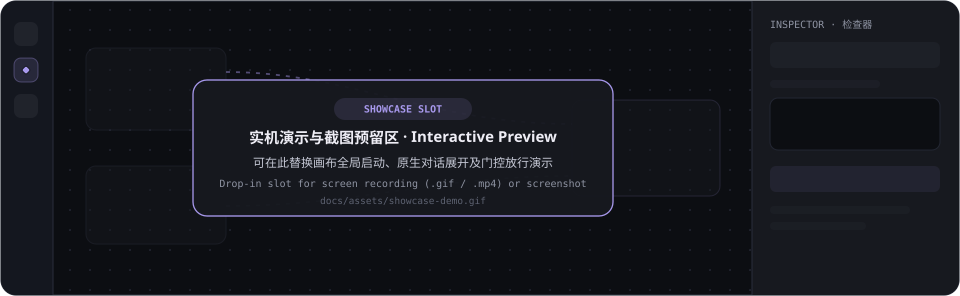
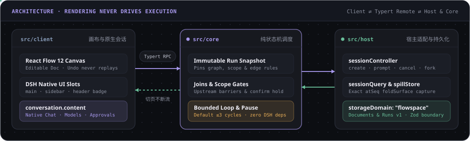

<div align="center">

<picture>
  <source media="(prefers-color-scheme: dark)" srcset="./docs/assets/hero-dark.svg" />
  <source media="(prefers-color-scheme: light)" srcset="./docs/assets/hero-light.svg" />
  
</picture>

<br />

<p>
  <a href="./docs/capabilities.md"><picture><source media="(prefers-color-scheme: dark)" srcset="./docs/assets/badge-dsh-dark.svg" /><source media="(prefers-color-scheme: light)" srcset="./docs/assets/badge-dsh-light.svg" /></picture></a>&nbsp;
  <a href="#快速上手"><picture><source media="(prefers-color-scheme: dark)" srcset="./docs/assets/badge-node-dark.svg" /><source media="(prefers-color-scheme: light)" srcset="./docs/assets/badge-node-light.svg" />= 24.9" src="./docs/assets/badge-node-dark.svg" height="24" /></picture></a>&nbsp;
  <a href="#系统架构"><picture><source media="(prefers-color-scheme: dark)" srcset="./docs/assets/badge-scheduler-dark.svg" /><source media="(prefers-color-scheme: light)" srcset="./docs/assets/badge-scheduler-light.svg" /></picture></a>&nbsp;
  <a href="./packages/flowspace/LICENSE"><picture><source media="(prefers-color-scheme: dark)" srcset="./docs/assets/badge-license-dark.svg" /><source media="(prefers-color-scheme: light)" srcset="./docs/assets/badge-license-light.svg" /></picture></a>
</p>

<p>
  <strong>面向 DeepSeek Harness <code>0.2.2-rc.3</code> 的持久化 Agent 无限画布与宿主级可视工作流插件</strong><br />
  <sub>每个节点绑定真实、可持续对话的 DSH Session · 引用线提供上下文 · 接续线推进工作 · 切页不断流</sub>
</p>

<p>
  <strong>简体中文</strong> · <a href="./README.en.md">English</a>
  &nbsp;&nbsp;｜&nbsp;&nbsp;
  <a href="#核心理念">核心理念</a> ·
  <a href="#连线语义与交互框架">连线语义</a> ·
  <a href="#实机预览">实机预览</a> ·
  <a href="#快速上手">快速上手</a> ·
  <a href="#系统架构">系统架构</a> ·
  <a href="#验证与演进路线">验证与路线</a>
</p>

</div>

<picture>
  <source media="(prefers-color-scheme: dark)" srcset="./docs/assets/divider-dark.svg" />
  <source media="(prefers-color-scheme: light)" srcset="./docs/assets/divider-light.svg" />
  
</picture>

## 核心理念

> [!NOTE]
> **文档状态说明**：当前 README 已完成视觉框架与核心工程指令搭建；带有 `TODO` 标记的段落预留给后续实机案例、交互动图与最佳实践补充。

<table>
<tr>
<td width="33%" valign="top">

### ◈ 真实持久化会话
每个 Agent 节点并非一次性脚本任务，而是绑定真实的 **DSH Session**。展开节点卡片即可直接复用 DSH 原生对话组件（模型切换、权限控制、附件、工具输出与人工审批）。

<sub>`TODO` · 补充单会话多轮追问与画布协同的典型工作流示例</sub>

</td>
<td width="33%" valign="top">

### ◆ 引用与接续解耦
严格区分**上下文供给**与**执行推进**：底部圆形端口（引用线）仅注入只读上下文且绝不触发运行；标题栏菱形端口（接续线）负责串行、并行、汇合与有界循环推进。

<sub>`TODO` · 补充复杂多 Agent 协作拓扑图例说明</sub>

</td>
<td width="33%" valign="top">

### ● 宿主级驻留调度
工作流状态机完全驻留在 **DSH Host** 侧，前端画布仅负责视图投影与编辑交互。切换侧栏页面不会中断正在运行的任务，画布撤销（Undo）也绝不会重放已发送的 Prompt。

<sub>`TODO` · 补充长耗时后台任务与重连恢复的使用提示</sub>

</td>
</tr>
</table>

<picture>
  <source media="(prefers-color-scheme: dark)" srcset="./docs/assets/divider-dark.svg" />
  <source media="(prefers-color-scheme: light)" srcset="./docs/assets/divider-light.svg" />
  
</picture>

## 连线语义与交互框架

<p align="center">
  <picture>
    <source media="(prefers-color-scheme: dark)" srcset="./docs/assets/ports-dark.svg" />
    <source media="(prefers-color-scheme: light)" srcset="./docs/assets/ports-light.svg" />
    
  </picture>
</p>

### 节点与连线速览

| 维度 | 类型 / 选项 | 行为边界与核心语义 |
| :--- | :--- | :--- |
| **画布节点** | `Agent` · `File` · `Display` · `Note` · `Group` | 双击创建新 Agent 或挂载已有 Session；支持基础两层分组、文件引用节点与结果展示节点 |
| **接续线（菱形）** | `自动` · `确认放行` · `不自动触发` | 连接标题栏左右 45° 菱形端口；支持多上游汇合等待（Join）与默认最多 `3` 轮的有界循环 |
| **引用线（圆形）** | `结论` · `会话文本快照` · `文件引用` | 连接底部圆形端口；快照仅提取用户/助手正文与压缩摘要（不含工具过程与推理），精确锁定 `atSeq` |
| **历史分叉（Fork）** | 仅限未启动草稿节点 | 在精确事件边界继承上游历史并保留原工作区，上游后续新增对话不会污染等待中的分叉载荷 |

<details>
<summary><strong>展开查看：运行控制、原生对话联动与持久化细节</strong></summary>

<br />

1. **启动范围与边界门控**：全局启动前可预览清单并取消特定起点；多选或分组运行在触达范围边界时自动停下等待人工放行。
2. **原生对话双向联动**：在 DSH 原生聊天页直接对话默认也会触发画布接续（可在画布全局设置或单节点检查器中覆盖）；原生对话标题栏右侧显示**接续状态徽章**，一键跳回对应画布节点。
3. **三级运行控制**：
   - **暂停（Pause）**：暂停后续新任务派发，已进入执行的当前回合继续结算。
   - **停止 Agent（Stop Node）**：取消指定节点正在执行的当前回合。
   - **取消运行（Cancel Run）**：仅取消该次工作流运行所拥有的任务。DSH 关闭或插件重载后，中断的运行需人工确认继续，绝不自动重放。
4. **草稿与数据存储**：任务预设用于自动接续，输入草稿用于下一次手动发送。画布自动保存至 `$DSH_HOME` 下的 `flowspace` storage domain（版本 `v1`），支持 JSON 导入/导出；删除画布节点不会删除底层 DSH Session。

> `TODO`：在此处补充检查器（Inspector）各配置项的图文对照表。

</details>

<picture>
  <source media="(prefers-color-scheme: dark)" srcset="./docs/assets/divider-dark.svg" />
  <source media="(prefers-color-scheme: light)" srcset="./docs/assets/divider-light.svg" />
  
</picture>

## 实机预览

<p align="center">
  <picture>
    <source media="(prefers-color-scheme: dark)" srcset="./docs/assets/showcase-placeholder-dark.svg" />
    <source media="(prefers-color-scheme: light)" srcset="./docs/assets/showcase-placeholder-light.svg" />
    
  </picture>
</p>

<table>
<tr>
<td width="33%" valign="top">

**01 · 画布编排与全局启动清单**  
<sub>`[待替换截图 / GIF]` · 展示多节点排布、两层分组折叠与启动前起点筛选清单。</sub>

</td>
<td width="33%" valign="top">

**02 · 节点内嵌原生对话与审批**  
<sub>`[待替换截图 / GIF]` · 展示双击展开卡片后的 DSH 原生会话、工具调用审批与引用胶囊状态。</sub>

</td>
<td width="33%" valign="top">

**03 · 并行汇合与确认门控放行**  
<sub>`[待替换截图 / GIF]` · 展示多路 Agent 并行结算、边界驻留预览及人工一键放行。</sub>

</td>
</tr>
</table>

<picture>
  <source media="(prefers-color-scheme: dark)" srcset="./docs/assets/divider-dark.svg" />
  <source media="(prefers-color-scheme: light)" srcset="./docs/assets/divider-light.svg" />
  
</picture>

## 快速上手

> **环境要求**：Node.js `>= 24.9.0`、`pnpm@11`，目标宿主版本为 `@deepseek-ai/dsh@0.2.2-rc.3`。

### 方式一：安装到现有 DSH 环境

先将本地 DSH 更新至 `0.2.2-rc.3`，随后构建插件包并执行安装脚本：

```bash
pnpm pack:plugin
node scripts/install.mjs --profile web
```

- 安装脚本会自动备份目标 profile 的 `manifest`、`patch` 与 `lockfile`，再通过 DSH CLI 安装本地包（可将 `web` 替换为任意独立 profile 名），不会覆盖你原有的模型配置。
- 安装完成后在 DSH 插件页启用 **FlowSpace**，即可从左侧边栏进入画布。

<details>
<summary>手动通过 DSH CLI 安装 / 停用与卸载命令</summary>

```bash
# 手动安装（建议先自行备份目标 profile）
dsh plugin --profile web add /absolute/path/to/dsh-flowspace-0.1.0.tgz

# 卸载插件（已有 DSH 会话与保存的画布数据均会保留）
dsh plugin --profile web remove dsh-flowspace
```

- **停用**：在 DSH 插件管理页关闭 FlowSpace 开关即可停止插件持有的后台调度。

</details>

### 方式二：本地独立沙盒开发与秒级热预览

可直接双击或运行仓库根目录的一体化启动与管理脚本（无需记忆繁琐命令，支持交互式控制台与快捷子命令）：

```bash
.\flowspace.cmd          # Windows CMD / PowerShell / 资源管理器直接双击打开交互菜单
```

```bash
./flowspace.sh           # Git Bash / macOS / Linux 打开交互菜单（等价于 pnpm start）
```

也可直接一行命令启动或管理：

```bash
./flowspace.sh dev       # 启动真实模型隔离沙盒（:3190）+ 双端秒级 HMR + 自动打开画布
```

```bash
./flowspace.sh mock      # 启动零账单模拟模型沙盒（:3191）+ 双端秒级 HMR + 自动打开画布
```

启动菜单的 **[10] 打开博物馆画布** 会在独立的 Mock 沙盒中打开预置展区。也可以运行 `./flowspace.sh museum` 或 `.\flowspace.cmd museum`。首次启动会布置全部 10 类节点、6 种内置工作流及一个可试跑的展签接续流程，后续打开继续使用 `.local/flowspace-museum` 中保存的画布。从左侧「工作流」可直接跳到各展区，「快照」中保留了初始布展。

「协作展区」预置了馆长和展签核对子代理的 DSH 会话。点消息线上的气泡可查看正文与方向，双击馆长下方的子代理卡可打开原生对话。已有博物馆在下次启动时会自动加入该展区。

- **完全隔离全局 DSH**：使用仓库内 `.local/flowspace`（真实模型）与 `.local/flowspace-mock`（模拟模型）作为独立 `$DSH_HOME`，不触碰日常 `~/.dsh` 与全局复杂插件，可与电脑已安装的 DSH 同时开启。首次启动若检测到全局 `~/.dsh/.credentials.yaml` 会单向同步凭据副本（可用 `--no-sync-auth` 关闭）。
- **源码级秒级无刷新热重载（Live HMR）**：常驻监听 `packages/flowspace/src/**`——修改前端 TSX/CSS 约几十毫秒自动增量打包并通过 `client-hmr` 无刷新热替换；修改 Host 服务或 `@Remote` 协议自动通过 `dsh-hmr` 内存级热重载并自动重连画布快照流。
- **独立沙盒多插件联调（`flowspace` / `pnpm sandbox`）**：可在该纯净测试 DSH 中仅安装所需测试插件而不污染全局：

```bash
./flowspace.sh status                       # 查看双沙盒运行状态、凭据与已装测试插件
./flowspace.sh link ../other-plugin --both  # 软链挂载另一个本地开发的插件到真实与 Mock 沙盒
./flowspace.sh add <pkg-or-tgz> --both      # 在隔离沙盒中安装其他测试插件
./flowspace.sh remove <pkg> --both          # 从隔离沙盒移除测试插件
./flowspace.sh auth --force                 # 重新从 ~/.dsh 单向同步模型凭据
./flowspace.sh reset --all --keep-plugins   # 一键备份并清空测试会话与画布脏数据
```

- **无自动弹窗后台开发命令（供编辑器或 CI 调用）**：

```bash
pnpm dev          # 默认端口 3190（真实模型沙盒，不自动弹系统浏览器）
pnpm dev:mock     # 默认端口 3191（独立 .local/flowspace-mock + 零账单确定性模拟模型）
```

> `dev:mock` 下会话、队列、持久化与事件流均为真实 DSH 运行时，仅模型输出替换为带 `【测试模型】` 标记的确定性夹具，适合无账单联调 UI 与调度逻辑。

<details>
<summary><code>TODO</code> · 常见问题排查（FAQ 预留折叠区）</summary>

<br />

- **Q1：如何导入或迁移画布模板？** — _待补充步骤说明（设置面板支持 JSON 导入与导出）_
- **Q2：DSH 重启后未完成的工作流如何恢复？** — _待补充中断状态识别与手动继续流程_

</details>

<picture>
  <source media="(prefers-color-scheme: dark)" srcset="./docs/assets/divider-dark.svg" />
  <source media="(prefers-color-scheme: light)" srcset="./docs/assets/divider-light.svg" />
  
</picture>

## 系统架构

<p align="center">
  <picture>
    <source media="(prefers-color-scheme: dark)" srcset="./docs/assets/architecture-dark.svg" />
    <source media="(prefers-color-scheme: light)" srcset="./docs/assets/architecture-light.svg" />
    
  </picture>
</p>

| 模块路径 | 核心职责 | 关键约束 |
| :--- | :--- | :--- |
| [`packages/flowspace/src/core`](./packages/flowspace/src/core) | 纯图结构与工作流调度状态机（串并行、Join 屏障、范围门控、有界循环） | 与 DSH 运行时完全解耦，可独立进行确定性单测 |
| [`packages/flowspace/src/host`](./packages/flowspace/src/host) | DSH `sessionController` 适配、精确 `atSeq` 引用提取、`flowspace` 存储域与 Typert Remote 根服务 | 唯一输入校验与副作用边界；锁定运行期图快照 |
| [`packages/flowspace/src/client`](./packages/flowspace/src/client) | React Flow 画布交互、DSH 原生 `slots` 挂载及 `conversation.content` 嵌入式会话复用 | 零调度逻辑；画布文档编辑历史与运行态严格分离 |

> [!IMPORTANT]
> **构建期适配说明**：Typert `0.2.2-rc.3` 生成器默认仅识别源码工作区内的 protocol 声明。[`scripts/build.mjs`](./scripts/build.mjs) 会在 `.local/build-tools` 中生成一份纯构建期适配以识别已发布 npm 包中的公开协议声明——**安装后的 DSH 宿主与插件运行时均无任何 Monkey Patch**。

<picture>
  <source media="(prefers-color-scheme: dark)" srcset="./docs/assets/divider-dark.svg" />
  <source media="(prefers-color-scheme: light)" srcset="./docs/assets/divider-light.svg" />
  
</picture>

## 验证与演进路线

### 质量与集成验证

```bash
pnpm check                            # 构建插件 + Host/Client 双端类型检查 + 调度单元测试
pnpm test:integration                 # rc.3 完整 Host + 确定性夹具端到端集成测试
pnpm exec tsx scripts/real-smoke.ts   # 使用已配置真实模型验证「并行 → 汇合 → 串行」（会产生模型用量）
```

> 真实模型冒烟测试在专用临时工作区运行四个简短任务，验证报告输出至 `artifacts/real-smoke.json`；请勿在日常 profile 上直接运行集成测试脚本。

### 版本边界与 Roadmap

- [x] 单张持久化无限画布、内置可编辑工作流示例与 JSON 导入/导出
- [x] 真实 DSH Session 绑定、内嵌原生对话与审批、原生聊天页接续联动徽章
- [x] 菱形接续线（自动 / 确认 / 有界循环）与圆形引用线（结论 / `foldSurface` 快照 / 文件引用 / 历史分叉）
- [x] 基础两层分组、中英双语界面与 DSH 深浅色主题同步
- [ ] `Roadmap` · 摘要交接（Summary Handoff）与跨画布模板版本同步
- [ ] `Roadmap` · 可编辑组合子图端口与复杂浮动检视窗
- [ ] `Roadmap` · 自动 Git Worktree 隔离、Team 通信集成与多机协作
- [ ] `TODO` · _在此补充下一阶段优先级里程碑_

### 延伸设计文档

- **视觉与交互设计依据**：[`docs/design.md`](./docs/design.md)
- **DSH `0.2.2-rc.3` 能力对接说明**：[`docs/capabilities.md`](./docs/capabilities.md)
- **验收与测试记录**：[`docs/verification.md`](./docs/verification.md)

<picture>
  <source media="(prefers-color-scheme: dark)" srcset="./docs/assets/divider-dark.svg" />
  <source media="(prefers-color-scheme: light)" srcset="./docs/assets/divider-light.svg" />
  
</picture>

<div align="center">
  <sub>
    Released under the <a href="./packages/flowspace/LICENSE">MIT License</a> ·
    Third-party notices in <a href="./packages/flowspace/THIRD_PARTY_NOTICES.md">THIRD_PARTY_NOTICES.md</a><br />
    Built for DeepSeek Harness <code>0.2.2-rc.3</code>
  </sub>
</div>
