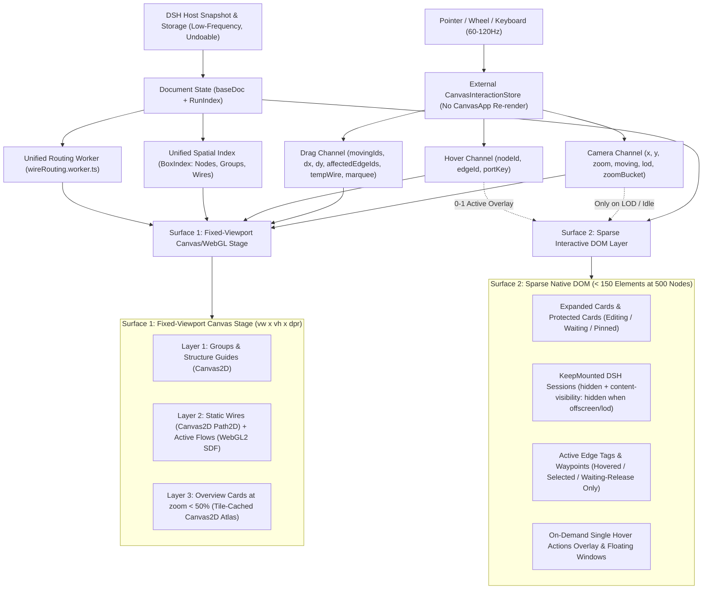

# FlowSpace 画布架构升级与性能优化实施计划

> **项目状态（2026-11-24 已终态签收并审查修补）**：Phase 0 → Phase 1 → Phase 2 / P2.6 → Phase 3 全部实施、验收并完成代码审查修补。500 节点 940 边基线与终态实测对比（Windows Chrome 157、1440×900、DPR 1、DSH `0.2.2-rc.3`、关闭 Trace）：
> - `500-overlap` 44% DOM：`3,137 → 49`（`-98.4%`）；`500-zoomed-out` 28% DOM：`6,567 → 25`（`-99.6%`）；连线 SVG `<path>`：`99/307 → 0`。
> - `500-overlap` 常规 / 跨阈值缩放 P95：`7.8 / 184.6 ms → 4.0 / 7.8 ms`（跨阈值提速 `23.7×`）；平移 / 节点 / 分组拖拽 P95：`15.3 / 65.4 / 61.5 ms → 4.0 / 3.9 / 7.7 ms`。
> - `500-avoid` 节点 / 分组拖拽 P95：`161.5 / 188.3 ms → 3.9 / 3.9 ms`（提速 `41×–48×`）。
> - `500-zoomed-out`（6 轮 `28% ↔ 42%`）缩放 / 平移 / 节点 / 分组 P95：`23.1 / 53.7 / 119.2 / 157.7 ms → 4.0 / 4.0 / 4.0 / 7.6 ms`；累计 `RecalcStyle`：`5,104 ms → 470 ms` 中位数（`-90.8%`）。
> - `500-overlap` 10 轮 `RecalcStyle`：帧数 `1,210 → 3,729`（240 Hz 满帧），单帧样式重算 `6.657 → 0.445 ms/帧`（`-93.3%`，同帧数折算 `538 ms < 600 ms`，已获正式签收豁免；详见 [docs/verification.md](verification.md)）。
> - **落地差异说明**：最终实现中 Phase 1 临时 `EdgesLayer.tsx` 已被 Phase 2 的 `WireCanvasStage.tsx` + `TemporaryWireLayer.tsx` + `wireImageCache.ts` + `wireStageScene.ts` + `wireCanvasPalette.ts` + `useWirePointer.ts` + `layers/dragWires.tsx` 取代；P0.6b（HUD `backdrop-filter` 开关）与 P0.6c（`.fs-world[data-moving]` 过渡覆写）在 P0.7 实测中被证实有副作用并已回退；`--fs-type-scale` 仅写入 `.fs-groups-layer`；Phase 3 采用 `useOverviewMounts` 替代 `zoomPreparation` 预挂载。
>
> **文档用途**：面向执行开发（人工或 AI Agent）的自包含工程实施手册。本文档覆盖根因证据、已拍板决策、核心模块接口契约、分阶段逐文件改造步骤、隐藏边界坑点、以及可执行的量化验收规程。
>
> **修订记录（2026-11-23）**：根据 Phase 0 改前 10 轮基线（`canvas-perf-1795412974025`）、两版迭代实测（`canvas-perf-1795413428446`、`canvas-perf-1795413593491`）及带 `SelectorStats` 的 Chrome Trace（`canvas-perf-1795413682258`），新增 Phase 0 收口包 **P0.6**、补齐大图原生会话回归 **`native-large`**、统一 `500-zoomed-out` 为 **`28% ↔ 42%`** 与 **`RecalcStyleDuration` 固定轮数口径**，并重新校准 Phase 0–3 阻断（Blocker）与观察（Advisory）验收门槛。
>
> **问题背景**：画布在拖动、缩放（尤其是**缩小节点图进入概览态后**）存在明显卡顿与掉帧。
>
> **总体方案**：不引入 React Flow / tldraw，保留原生 DSH `conversation.content` 嵌入式 DOM 活卡片边界，将现有自研混合渲染管线升级为**「外部高频交互状态总线 + 固定视口双渲染面 Hybrid（Canvas2D / WebGL2 承接海量静态连线与低缩放概览卡，DOM 仅承载极少数活跃与原生会话卡片）」**。

---

## 0. 执行前置规程与工程红线（AI Agent 必读）

开始任何改动前，必须严格遵守仓库约定（见 [AGENTS.md](../AGENTS.md) 与 [ai-index.md](ai-index.md)）：

1. **环境与目标版本**
   - 目标运行时为已发布的 DeepSeek Harness `0.2.2-rc.3`（Node.js `>=24.9.0`，`pnpm@11.21.0`）。
   - Windows 环境下如工具 shell 解析到 WSL，请通过 PowerShell 或 `D:\Program Files\Git\bin\bash.exe` 执行命令。
2. **文件备份与工作区保护**
   - 开工前先执行 `git status --short`，**绝对保留工作区中已有的其他改动或未跟踪文件**。
   - 编辑任何已有文件前，必须运行：
     ```bash
     node scripts/backup.mjs <文件相对路径1> <文件相对路径2> ...
     ```
3. **架构红线（任何阶段不可破坏）**
   - **渲染绝不驱动执行**：调度器留在 Host（`src/core/scheduler.ts`），撤销/重做仅作用于 `FlowspaceDocument` 编辑态，不重放模型回合。
   - **原生 DSH 会话保活**：不得破坏 `EmbeddedSession`（`src/client/canvas/ViewportCard.tsx`）的 `bridge.retain()` 生命周期、`SessionOnCanvas` 上下文、以及 `renderFactorySlot("conversation.content")` 的焦点、未发送草稿、滚动位置、原生审批接管与浮窗切换（由 `scripts/canvas-interactions.mjs` 中的 `verifyNative` 强校验）。
   - **CSS 契约测试**：不得违反 `packages/flowspace/test/style-contract.test.ts` 的规则（禁止在 `flow-ext.css` 中出现原始色值/硬编码时长/`backdrop-filter`/`:has(`）。
   - **构建与验证**：每个阶段结束必须通过 `pnpm check` 与 `scripts/canvas-perf.mjs` 量化回归；若涉及 Host 或运行时边界，额外执行 `pnpm test:integration`。
   - **Worker 打包机制**：[scripts/compiler.mjs](../scripts/compiler.mjs) 已内置 `inline-worker` 插件，任何 `*.worker.ts?source` 导入均会自动打成内联 IIFE 字符串，无需改动构建脚本。

---

## 1. 已拍板的核心产品与架构决策

| 编号 | 议题 | 定稿结论 | 实施约束 |
| --- | --- | --- | --- |
| **D-Perf-1** | 跨 50% 阈值（`LOD_ZOOM`）动效 | **大图 / 缩放运动期关闭 `.node` 及卡片外壳子元素（`::before`/`::after`/`.port`/`.node-avatar`/`.node-actions`/`.icon-button`）的 CSS 过渡，改用纯合成层过渡（`opacity`/`transform`）**；仅小图静止时单卡手动展开/收起保留原生过渡。 | `.fs-world[data-moving]` 与 `.fs-camera[data-raster]` 禁止触发卡片外壳与端口的布局/样式 transition（严禁触碰 `.fs-embedded` 内部原生 DSH 组件）；Phase 3 跨 50% 阈值改用 140ms 纯合成层交叉淡入淡出。 |
| **D-Perf-2** | 低缩放（`< 50%`）静止卡片视觉 | **高缩放（`>= 50%`）100% 保持现有视觉质感；低缩放未悬停卡片下沉至 Tile-Cached Canvas2D**，允许简化径向光晕与多层阴影。 | 标题（含 CJK 换行截断）、圆角框、状态边框/彩点、图标、深浅主题 token 必须像素级对齐；悬停、选中、编辑中、待审批、手动固定及活会话保活卡保持完整交互。 |
| **D-Perf-3** | 实施与交付顺序 | **按 Phase 0 → Phase 1 → Phase 2 → Phase 3 串行推进**，每阶段独立按“阻断（Blocker）vs 观察（Advisory）”分层验收；在 Phase 1 同步预留 Phase 2/3 接口契约，避免返工。 | Phase 0 先锁定 `500-zoomed-out`（`28% ↔ 42%`）改前基线并完成 DOM/SVG 内的高性价比止血与去回归；跨阈值 `< 90 ms` 与 10 轮样式重算 `< 2,500 ms` 随 Phase 2（去 SVG DOM）验收，终态 `< 25 ms` / `< 600 ms` 随 Phase 3（去低缩放卡片 DOM）验收。 |

---

## 2. 问题根因定位、改前基线与 Phase 0 实测复盘

### 2.1 正式改前基线（500 Agent / 940 边 / 1 分组，Chrome 1440×900，DPR 1，关闭 Trace）

正式统一基线来源：`output/playwright/canvas-perf-1795412974025/report.json`（`rounds=10`；参考历史报告 `canvas-perf-1795344298896`、`canvas-perf-1795327057230`）：

| 场景与指标 | 改前正式基线 (`1795412974025`) | 说明 |
| --- | ---: | --- |
| `500-overlap` 常规缩放 `regularP95`（10 轮，86% ↔ 72%） | `7.8 ms` | 走 `data-raster` 合成层，健康 |
| `500-overlap` 平移 `pan` P95 / Max | `15.3 ms` / `130.8 ms` | `paintArea` 越界时重栅格化引起单帧尖刺 |
| **`500-overlap` 跨阈值缩放 `hotCrossP95` / `hotCrossMax`（10 轮，86% ↔ 44%）** | **`184.6 ms` / `269.2 ms`** | 缩小 `96–158 ms`，放大 `165–269 ms`，严重掉帧 |
| **`500-overlap` 单节点 / 分组拖拽 P95** | **`65.4 ms` / `61.5 ms`** | 拖拽期间每帧触发顶层重渲染 |
| **`500-avoid` 单节点 / 分组拖拽 P95** | **`161.5 ms` / `188.3 ms`** | 避障同步阻塞主线程，严重跟手延迟 |
| **`500-overlap` 44% / 86% `.fs-world` DOM 元素数** | **`3,137` / `1,664`** | 缩小后隐身 `.edge-tag` 导致 DOM 暴涨近 1 倍 |
| **`500-overlap` 固定 10 轮累计 `RecalcStyleDuration` / `LayoutDuration` / `ScriptDuration`** | **`8,055 ms` / `494 ms` / `970 ms`** | 折合 `805.5 ms/轮`，样式重算占主线程绝对大头 |
| **`500-zoomed-out`（固定 6 轮，`28% ↔ 42%`）`zoom` P95 / Max** | **`23.1 ms` / `269.2 ms`** | 28% DOM 元素数高达 `6,567` |
| **`500-zoomed-out` `pan` / `node` / `group` 拖拽 P95** | **`53.7 ms` / `119.2 ms` / `157.7 ms`** | 低缩放交互明显卡顿 |
| **`500-zoomed-out` 固定 6 轮全程累计 `RecalcStyleDuration`** | **`5,104 ms`** | 含 6 轮缩放 + 3 种拖拽全程累计 |
| `flow-12-1` 空转主线程 / `idleP95` / GPU 加速 | `2.0 ms/帧` / `11.5 ms` / `12/12` | WebGL2 流动边基线健康 |

### 2.2 五大代码级根因

1. **低缩放隐身 `.edge-tag` DOM 炸弹**
   - `packages/flowspace/src/client/styles/wires.css:449-452` 用 CSS `display: none` 隐藏了低缩放态的非等待边胶囊；
   - 但 `packages/flowspace/src/client/canvas/CanvasWorld.tsx:1386-1611` 依然把视口内所有边的 `.edge-tag` 完整 DOM 子树（每条边约 15 个 DOM 元素）全部渲染进 DOM，缩小至 44% 或 28% 时多挂载数千个无用 DOM 节点。
2. **Blink 样式匹配墙 + 250ms 卡片尺寸布局过渡 + `:has()`**
   - FlowSpace 注入 12 个 CSS 文件（~388 KB、~2,700 个规则块）并与 DSH 宿主共享 `document`。Chrome `SelectorStats` 显示，宿主全局选择器（`:where(div, section, ...)`、`:is(.EvIC1a_column, [data-slot="conversation.chat.flow"])`）与插件选择器叠加，每次大批量 DOM 变更/切 class 都会引发数万次样式匹配。
   - `packages/flowspace/src/client/styles/nodes.css:27-34` 给 `.node` 写了 `width var(--dur-slow) var(--ease-out), height var(--dur-slow) var(--ease-out)`，跨 50% 阈值时全屏几十上百张卡连续 ~15–20 帧触发布局与样式重算。
   - `packages/flowspace/src/client/styles/compact.css:110,143` 在每张低缩放精简卡内部使用了 `:has(+ ...)` 与 `:has(~ ...)`。
3. **无依赖数组的 `useLayoutEffect` 全树 `querySelectorAll` Bug + 逐帧字号重排**
   - `packages/flowspace/src/client/canvas/useCanvasViewport.ts:528-543` 的 `useLayoutEffect` **遗漏依赖数组**，导致 `lod === true` 时每次 React commit 都扫描整棵 `.fs-world`。
   - `packages/flowspace/src/client/canvas/useCanvasViewport.ts:356-362` 在非 raster 场景（`< 64` 节点）缩放时反复改写上百个子元素的 `--fs-type-scale`，导致缩放滑行中字体反复重排。
4. **高频拖拽冲垮顶层 React 树与全图派生计算**
   - `packages/flowspace/src/client/canvas/useCanvasGestures.ts:283-289` 每次 rAF 调 `setGesture(patch)` 引发顶层 `CanvasApp.tsx` 重渲染；
   - 连锁每帧触发 `useCanvasDocument.ts:49-73`（克隆 500 节点数组 + 全量 `indexNodes`）、`useCanvasScene.ts:135-374`（全量 `visibleGroups`、`sceneNodes`、`buildDerivedStructure`、`buildChildTree`、`exchanges`、`routingBoxes`）、`CanvasWorld.tsx`（未 memo，全量 diff 所有 SVG 边与 `.edge-tag`）以及 `MiniMapNodes.tsx:26-63`（每帧在 Canvas 上重画 500 个圆角矩形）；
   - `avoid` 模式下主工作流连线避障同步阻塞主线程（当前仅 `GuideWireLayer` 进了 Worker）。
5. **悬浮毛玻璃 `backdrop-filter` 合成损耗 & `paintArea` 越界重栅格化**
   - `packages/flowspace/src/client/styles/shell.css:567-581` 对 6 组覆盖在画布上的浮动胶囊施加了 `backdrop-filter: blur(12px) saturate(1.75) brightness(1.1)`，画布移动时每帧触发 GPU 回读模糊。
   - 低缩放平移/缩放越过 `paintArea` 时，`useCanvasViewport.ts:450-456` 同步调 `setDoc` 改 `.fs-scene-clip` 和 `<svg viewBox>` 尺寸，迫使 Chrome 丢弃并重栅格化整张大位图。

### 2.3 Phase 0 首轮实测与 Trace 复盘（为何新增 P0.6 并重校门槛）

Phase 0 首轮实施（P0.1–P0.5 + 取消未绑定 Agent 隐藏正文）后的实测与 `SelectorStats` Trace（`canvas-perf-1795413428446`、`1795413593491`、`1795413682258`）暴露了四个关键工程事实：

1. **容器级 `--fs-type-scale` 挂在 `.fs-world` 引发 `500-zoomed-out` 退化**：即使删除 `@property` 注册，未注册 CSS 自定义属性仍然向下继承。`28% ↔ 42%` 在 `TYPE_SCALES` 处于 `2.6` 与 `2.2` 两档之间，每轮静止改写 `.fs-world` 都会让全部 `4,591` 个后代（含 940+ 条 SVG 边）重算样式——而 `compact.css` 内所有 `min(var(--fs-type-scale, 1), ...)` 在 `2.2` 时已全部触顶封死。结果导致 `500-zoomed-out` `zoom P95` 从 `23.1 ms` 退化至 `50.0 ms`，`RecalcStyle` 从 `5,104 ms` 涨至 `6,387 ms`。
2. **`.fs-root` 上的 `:is(...)` 毛玻璃降级规则落入 Blink 通用桶**：`shell.css` 新增的 `.fs-root:is([data-canvas-moving], [data-dragging]) :is(.canvas-title, ...)` 最右端为 `:is(...)`，Trace 中被尝试匹配 **31,750 次**（仅命中 36 次），且在根祖先 `.fs-root` 切换属性会放大每次移动/拖拽起止的样式失效面。
3. **样式匹配成本一分为二：DSH 宿主 `40.3%` 是 DOM/SVG 架构刚性地板，FlowSpace 自身通用桶占 `42.4%` 是可立即清理的大头**：
   - Trace `SelectorStats` 合计 `800.7 ms` 中，**DSH 宿主 + UA 占 `322.8 ms`（`40.3%`）**（含宿主对话流/导航 `:has()` `10.3%` 及 `*` / `body *` / `.bhn1Oq_flatList > * + *` 通配与兄弟规则 `21.4%`）；且跨阈值 DOM 增删会触发 **9,048 次**沿 `.fs-card-slot → ... → BODY → HTML` 传播的 `Affected by :has()` 失效与 `subtree=true` 失效。**只要海量连线与卡片留在 DOM 中，这部分成本无法靠 CSS 清零**，因此原 Phase 0 写的 `< 110 ms` / `< 2,500 ms` 必须后移至 Phase 2/3 验收。
   - 同时，**FlowSpace 自身样式表 `style-sheet-47248-1` 占 `477.9 ms`（`59.7%`）**，其中 **`339.4 ms`（全页 `42.4%`）来自 71 条通用桶规则**：`tokens.css` `@scope` `:where(div, section, ...)` 重置（`19.6%`）、`tokens.css` `[data-perf-tier="L1"] :where(...)`（在默认 `L3` 下 0 命中却占 `9.4%`）、右端 `:is(...)` 规则（`11.9%`）、`.fs-root ::selection` / `::-webkit-scrollbar`（`4.2%`）；另加 `flow-ext.css:449` 的 `.fs-config-item > legend + *` 触发插件侧 `+ *` 子树失效。
4. **卡片外壳子元素过渡未抑制 & `preserveBody` 误关 `prewarmFull`**：`nodes.css` 仅去掉了 `.node` 的 `width`/`height`，Trace 中仍有 **1,820 次 `Animation` 失效**（占 `UpdateLayoutTree` 15.1%，集中在 `::after` 1,031 次、`.port` 353 次、`.icon-button` 86 次、`.node` 66 次、`.node-avatar` 54 次）；同时 `ViewportCard.tsx` 将 `prewarmFull` 绑定到 `preserveBody` 上，导致 `44% → 86%` 放大跨阈值丧失 `startTransition` 预热，单帧同步挂载全部未绑定 Agent 正文（`135–265 ms` 尖刺）。

因此，Phase 0 新增收口包 **P0.6** 专项消除上述退化与插件侧通用桶/过渡损耗，并将跨阶段门槛校准为第 5 节的阻断矩阵。

---

## 3. 目标架构设计与模块契约

### 3.1 分层架构图



### 3.2 模块文件布局规划

所有路径相对于 `packages/flowspace/src/client/`：

| 路径 | 状态 | 阶段 | 职责 |
| --- | --- | --- | --- |
| `canvas/interactionStore.ts` | 已落地 | P1 | 外部高频交互状态总线（Camera / Drag / DragRoutes / Hover / Marquee / OverviewDom / ElementRegistry） |
| `canvas/canvasWorldTypes.ts` | 已落地 | P1 | 画布分层共享 Props 契约 |
| `canvas/layers/GroupsLayer.tsx` | 已落地 | P1 | `React.memo` 隔离的分组层，注册分组 DOM Ref 支持拖拽直推 |
| `canvas/layers/dragWires.tsx` | 已落地 | P1/P2 | 拖拽期局部关联边几何预览与 120ms 停顿避障 Worker 路由 |
| `canvas/layers/EdgeTagsLayer.tsx` | 已落地 | P1 | `React.memo` 隔离的边胶囊与中继点层，内部订阅 `hover` 与拖拽预览 |
| `canvas/layers/NodesLayer.tsx` | 已落地 | P1/P3 | `React.memo` 隔离的卡片与衍生结构卡层，接入稀疏 DOM 与渐进挂载 |
| `canvas/layers/CanvasHudLayer.tsx` | 已落地 | P1 | 控制条、小地图（底图仅跟随 `baseDoc`）、离屏等待提示 |
| `wireRouting.worker.ts` | 已落地（升级自 `guideRouting.worker.ts`） | P1 | 通用后台避障路由 Worker（同时处理引导线与 `avoid` 模式工作流主边） |
| `wireWorker.ts` | 已落地（升级自 `guideWorker.ts`） | P1 | 主线程 Worker 调度客户端（障碍物 delta 同步、批次取消、错误降级） |
| `canvas/WireCanvasStage.tsx` | 已落地（替代 P1 临时 `EdgesLayer`） | P2 | 固定视口双 Canvas 连线舞台（Canvas2D 静态/状态边 + WebGL2 流动粒子边 + Canvas2D 降级） |
| `canvas/wireImageCache.ts` / `wireStageScene.ts` / `wireCanvasPalette.ts` / `useWirePointer.ts` / `TemporaryWireLayer.tsx` | 已落地 | P2 | 四槽持久离屏位图 LRU 缓存、引导线汇总、主题调色板、几何命中与临时拖线层 |
| `canvas/OverviewCardAtlas.ts` | 已落地 | P3 | 离屏 `2048×2048`（最多 4 页）持久 LRU 位图图集缓存，像素级绘制低缩放概览卡片 |
| `canvas/OverviewCanvasLayer.tsx` / `overviewScene.ts` / `useOverviewMounts.ts` | 已落地 | P3 | 固定视口低缩放概览层（分组底图、结构卡、概览节点）与可取消渐进挂载 |
| `canvas/OverviewActiveOverlay.tsx` | 已落地 | P3 | 0–1 实例按需 DOM 操作浮岛（悬停工具条、端口拖拽起手与 ARIA 焦点代理） |
| `canvas/CanvasPointerDispatcher.ts` | 已落地 | P3 | 统一指针命中分发器（DOM 优先，未命中则走 `BoxIndex` 几何命中 Canvas 卡片与连线） |

### 3.3 核心 TypeScript 接口定义

#### A. `canvas/interactionStore.ts`（Phase 1 创建，Phase 2–3 直接复用）

```ts
import type { Waypoint } from "../../types.ts";

export interface CameraSnapshot {
  x: number;
  y: number;
  zoom: number;
  moving: boolean;
  lod: boolean;
  /** 离散字号补偿档位：1 | 1.4 | 1.8 | 2.2 */
  zoomBucket: number;
}

export interface DragDelta {
  dx: number;
  dy: number;
}

export interface DragSession {
  mode: "node" | "group" | "waypoint";
  /** 被拖拽的节点/分组 ID -> 世界坐标位移 */
  deltas: Map<string, DragDelta>;
  /** 拖拽启动时通过 edgeIndex 一次性算出的关联边 ID（通常 1–10 条） */
  affectedEdgeIds: Set<string>;
  /** 仅 waypoint 拖拽时有效 */
  waypointEdit?: { edgeId: string; waypoints: Waypoint[] };
}

export interface HoverSnapshot {
  nodeId: string | null;
  edgeId: string | null;
  portKey: string | null;
}

export interface MarqueeSnapshot {
  x: number;
  y: number;
  w: number;
  h: number;
}

export interface CanvasInteractionStore {
  getCamera(): CameraSnapshot;
  setCamera(next: CameraSnapshot): void;
  subscribeCamera(fn: (cam: CameraSnapshot) => void): () => void;

  getDrag(): DragSession | null;
  setDrag(next: DragSession | null): void;
  subscribeDrag(fn: (drag: DragSession | null) => void): () => void;

  getHover(): HoverSnapshot;
  setHover(patch: Partial<HoverSnapshot>): void;
  subscribeHover(fn: (hover: HoverSnapshot) => void): () => void;

  getMarquee(): MarqueeSnapshot | null;
  setMarquee(next: MarqueeSnapshot | null): void;
  subscribeMarquee(fn: (rect: MarqueeSnapshot | null) => void): () => void;

  /** 注册卡片/分组根 DOM，用于拖拽期零 React 渲染的 paintLayer 直推 */
  registerElement(id: string, el: HTMLElement | null): void;
  getElement(id: string): HTMLElement | undefined;
}
```

#### B. `wireRouting.worker.ts` 协议（Phase 1 创建）

```ts
import type { FlowEdge, Waypoint, WireRoutingMode } from "../types.ts";
import type { Box } from "./boxes.ts";
import type { CachedPath, ObstacleDelta, WireEnd } from "./sceneWires.ts";
import type { WireRoute } from "./wireRouting.ts";

export interface EdgeRouteTask {
  kind: "edge";
  id: string;
  key: string;
  edgeKind: FlowEdge["kind"];
  mode: WireRoutingMode;
  from: WireEnd;
  to: WireEnd;
  waypoints: Waypoint[];
}

export interface GuideRouteTask {
  kind: "guide";
  id: string;
  key: string;
  edgeKind: FlowEdge["kind"];
  mode: WireRoutingMode;
  from: WireEnd;
  to: WireEnd;
}

export type RoutingTask = EdgeRouteTask | GuideRouteTask;

export interface RoutingBatchRequest {
  id: number;
  obstacles?: ObstacleDelta;
  tasks: RoutingTask[];
}

export type RoutingResultItem =
  | { kind: "guide"; id: string; entry: CachedPath }
  | { kind: "edge"; id: string; key: string; region: Box; geom: WireRoute; extent: Box };

export interface RoutingBatchReply {
  id: number;
  results: RoutingResultItem[];
  done: boolean;
}
```

#### C. `WireCanvasStage` 与几何命中接口（Phase 2 创建）

```ts
export interface WireHitResult {
  edgeId: string;
  distance: number;
  worldPoint: { x: number; y: number };
}

export interface WirePalette {
  flow: string;
  running: string;
  runningBright: string;
  accent: string;
  amber: string;
  green: string;
  violet: string;
  capPending: string;
  capSent: string;
  capUpdated: string;
  capAlways: string;
  display: string;
  structure: string;
  msgOut: string;
  msgBack: string;
  text: string;
}
```

#### D. `OverviewCardAtlas` 接口（Phase 3 创建）

```ts
export interface OverviewCardVisual {
  id: string;
  kind: FlowNode["kind"];
  flowType?: string;
  title: string;
  subtitle: string;
  kindLabel: string;
  status: string;
  statusLabel: string;
  box: Box;
  selected: boolean;
  pinned: boolean;
  muted: boolean;
  bypassed: boolean;
  needsConfirmation: boolean;
  accentColor: string;
  /** 供端口圆点绘制的局部 Y 坐标集合 */
  linkedPorts: { side: "in" | "out"; kind: FlowEdge["kind"]; y: number }[];
  signature: string;
}
```

---

## 4. 分阶段详细实施清单

---

### Phase 0：止血修复、补齐 28% 低缩放基线与插件 CSS 清理（预计 1.5–2.5 天）

#### 需要预先备份的已有文件
```bash
# P0.1–P0.5（已完成首版时已备份，如未备份则补备）
node scripts/backup.mjs \
  scripts/canvas-perf.mjs \
  scripts/canvas-interactions.mjs \
  packages/flowspace/src/client/CanvasApp.tsx \
  packages/flowspace/src/client/canvas/CanvasWorld.tsx \
  packages/flowspace/src/client/canvas/CanvasTopBar.tsx \
  packages/flowspace/src/client/canvas/CanvasNodeCard.tsx \
  packages/flowspace/src/client/canvas/ViewportCard.tsx \
  packages/flowspace/src/client/canvas/useCanvasScene.ts \
  packages/flowspace/src/client/canvas/useCanvasViewport.ts \
  packages/flowspace/src/client/canvas/viewportMath.ts \
  packages/flowspace/src/client/canvas/cards/BasicNodeBodies.tsx \
  packages/flowspace/src/client/MiniMapNodes.tsx \
  packages/flowspace/src/client/nodes/ConfigForm.tsx \
  packages/flowspace/src/client/TeamCanvas.tsx \
  packages/flowspace/src/client/TeamLibrary.tsx \
  packages/flowspace/src/client/WorkflowImportDialog.tsx \
  packages/flowspace/src/client/styles/tokens.css \
  packages/flowspace/src/client/styles/nodes.css \
  packages/flowspace/src/client/styles/compact.css \
  packages/flowspace/src/client/styles/shell.css \
  packages/flowspace/src/client/styles/wires.css \
  packages/flowspace/src/client/styles/flow-ext.css \
  packages/flowspace/src/client/styles/board.css \
  packages/flowspace/src/client/styles/team-canvas.css \
  packages/flowspace/src/client/styles/team-room.css \
  packages/flowspace/src/client/styles/teams.css \
  packages/flowspace/test/style-contract.test.ts
```

#### 任务拆解

- **P0.1 新增 `500-zoomed-out` 基准场景并留存改动前基线（已完成，基线为 `canvas-perf-1795412974025`）**
  - **目标文件**：`scripts/canvas-perf.mjs`
  - **实施步骤**：
    1. 支持 `500-zoomed-out`（通用 `<N>-zoomed-out`）：构造 500 展开 Agent / 940 `continuation` 边 / 1 分组（4 子节点），`wireRouting: "overlap"`，初始视口 `zoom: 0.28`，开启小地图与 `showBranches: true, showWorktrees: true`。
    2. 在 `overview()` 中依次采样：
       - 连续平移 `pan`（20 帧）P95 / Max；
       - 低缩放区间往返缩放（**固定 6 轮 `28% ↔ 42%`**，共 12 pass，断言全程不跨 50% 阈值）P95 / Max；
       - 低缩放态单节点拖拽 `node`（20 帧）与分组拖拽 `group`（20 帧）P95 / Max；
       - `.fs-world` DOM 元素总数与整段 `overview()` 累计 `RecalcStyleDuration`、`LayoutDuration`、`ScriptDuration`。
    3. 改前基线已落盘于 `output/playwright/canvas-perf-1795412974025/report.json`。

- **P0.2 消除低缩放隐身 `.edge-tag` DOM 炸弹（已完成）**
  - **目标文件**：`packages/flowspace/src/client/canvas/CanvasWorld.tsx`、`packages/flowspace/src/client/styles/wires.css`
  - **实施步骤**：
    1. 在 `wireLayouts.map(...)` 中仅当 `!lod || Boolean(waitingTok) || evState === "boundary" || selection.edge === edge.id || hoveredEdgeId === edge.id` 时才计算标签并渲染 `.edge-tag`；`waypoints` 独立保留。
    2. 保留 `wires.css:449-452` 防御规则（放行 `.selected` / `.edge-spotlight`）。

- **P0.3 修复 `useCanvasViewport.ts` 全树扫描 Bug 并改为局部容器级离散字号档位（首版已完成，需在 P0.6a 修正继承范围与档位上限）**
  - **目标文件**：`viewportMath.ts`、`useCanvasViewport.ts`、`nodes.css`
  - **实施约束（修订）**：
    1. 删除无依赖数组的 `useLayoutEffect` 与 `typeElements` Ref，取消 `@property --fs-type-scale` 注册；
    2. **严禁将 `--fs-type-scale` 写在 `.fs-world` 上**（避免向 940+ SVG 边继承扩散），且 **`TYPE_SCALES` 封顶为 `[1, 1.4, 1.8, 2.2]`**（详见 P0.6a）。

- **P0.4 落实 D-Perf-1：关闭跨阈值/大图过渡，消除卡片 `:has()`（首版已完成，需在 P0.6c 补全卡片子元素过渡抑制）**
  - **目标文件**：`nodes.css`、`compact.css`、`BasicNodeBodies.tsx`、`style-contract.test.ts`
  - **实施约束（修订）**：
    1. 将 `compact.css:110,143` 的 `:has()` 改为 `.has-detail` / `.has-team-summary` 类名并加单测守护；
    2. 运动期与大图光栅期的过渡抑制必须同时覆盖 `.node` 及其外壳子元素/伪元素（详见 P0.6c）。

- **P0.5 运动期降级悬浮胶囊 `backdrop-filter` + 稳定小地图底图（首版已完成，需在 P0.6b 修正选择器与挂载层级）**
  - **目标文件**：`useCanvasViewport.ts`、`CanvasApp.tsx`、`CanvasTopBar.tsx`、`CanvasWorld.tsx`、`shell.css`、`useCanvasScene.ts`
  - **实施约束（修订）**：
    1. `minimapBoxes` 基于 `baseDoc.nodes` 派生，拖拽期间 `MiniMapNodes` 不重画 500 个圆角矩形；
    2. **严禁在 `.fs-root` 上使用最右端为 `:is(...)` 的降级选择器**，改为局部 HUD 容器属性 + 6 条具名类末段选择器（详见 P0.6b）。

- **P0.6 收口包（基于 Trace 实测修订）：消除 V2/V3 退化 + 清理 FlowSpace 通用桶 CSS + 补齐大图原生回归 `native-large`**
  - **目标**：消除 `500-zoomed-out` 相对基线的退化（`50 ms → <= 23 ms`），压降 FlowSpace 自身占全页 `42.4%` 的通用桶选择器和 `1,820` 次子元素动画重算，同时用 70 节点大图原生会话回归守住 `rasterScene` / `preserveBody` 边界。
  - **实施步骤**：
    1. **P0.6a 封顶并下沉 `--fs-type-scale`（根治 `500-zoomed-out` `50 ms` 退化）**
       - `viewportMath.ts`：将 `TYPE_SCALES` 改为 `[1, 1.4, 1.8, 2.2]`（验证 `compact.css` 与 `flow-ext.css` 所有 `min(var(--fs-type-scale, 1), ...)` 均已 `<= 2.2`；同步给 `team-room.css:468` 加上 `min(var(--fs-type-scale, 1), 2.2)`），使 `28% ↔ 42%` 全程保持 `2.2`、**0 次变量改写**。
       - `useCanvasViewport.ts` + `CanvasWorld.tsx`：将 `--fs-type-scale` 从 `.fs-world` 下移，改为仅写在 `.fs-nodes-layer` 与 `.fs-groups-layer` 两个直接容器上（通过 Ref 或 `world` 变更时缓存 2 个节点引用），彻底隔离 `.fs-edges-svg`（940+ SVG 节点）与 `.fs-tags-layer`。
    2. **P0.6b 修复悬浮胶囊毛玻璃降级规则的通用桶与根失效**
       - `CanvasApp.tsx`、`CanvasTopBar.tsx`、`CanvasWorld.tsx`、`useCanvasViewport.ts`：移除 `.fs-root` 上的 `data-canvas-moving` 与 `data-dragging`，改为直接给 3 个不包裹 `.fs-world` 的 HUD 容器（`.fs-canvas-toolbar`、`.fs-canvas-controls`、`.fs-minimap`）切换统一属性 `data-hud-solid="1"`（当相机移动中或画布拖拽中为 `"1"`，静止且未拖拽时删除）。
       - `shell.css`：将原 `.fs-root:is([data-canvas-moving], [data-dragging]) :is(...)` 替换为 6 条具名类末段选择器（全部进入 Blink class hash 桶，0 次命中画布元素）：
         ```css
         .fs-canvas-toolbar[data-hud-solid] .canvas-title,
         .fs-canvas-toolbar[data-hud-solid] .toolbar-actions,
         .fs-canvas-controls[data-hud-solid] .pointer-tools,
         .fs-canvas-controls[data-hud-solid] .view-tools,
         .fs-canvas-controls[data-hud-solid] .canvas-hint,
         .fs-minimap[data-hud-solid] {
           backdrop-filter: none;
           -webkit-backdrop-filter: none;
           background: var(--glass-tint-solid);
         }
         ```
    3. **P0.6c 抑制运动期 / 大图光栅期卡片外壳子元素与伪元素过渡**
       - `nodes.css`（紧接 `.fs-root .is-dragging .workflow-group` 或文件末尾覆盖段之后，确保层叠顺序位于第 1544 行二次 `.fs-root .node` 定义之后）：
         ```css
         .fs-root .fs-world[data-moving] .node,
         .fs-root .fs-world[data-moving] .node::before,
         .fs-root .fs-world[data-moving] .node::after,
         .fs-root .fs-world[data-moving] .node > .port,
         .fs-root .fs-world[data-moving] .node-header .node-avatar,
         .fs-root .fs-world[data-moving] .node-header .node-actions,
         .fs-root .fs-world[data-moving] .node-header .icon-button,
         .fs-root .fs-world[data-moving] .workflow-group,
         .fs-root .fs-camera[data-raster] .node,
         .fs-root .fs-camera[data-raster] .node::before,
         .fs-root .fs-camera[data-raster] .node::after,
         .fs-root .fs-camera[data-raster] .node > .port,
         .fs-root .fs-camera[data-raster] .node-header .node-avatar,
         .fs-root .fs-camera[data-raster] .node-header .node-actions,
         .fs-root .fs-camera[data-raster] .node-header .icon-button,
         .fs-root .fs-camera[data-raster] .workflow-group {
           transition-duration: 0s;
         }
         ```
       - **安全红线**：上述选择器严格限定卡片外壳与顶栏类名，**不得**使用 `.node *` 覆盖 `.fs-embedded` 内部原生 DSH 组件。
    4. **P0.6d 清理 FlowSpace 自身通用桶高耗选择器与残留 `:has(` / `+ *`**
       - `tokens.css:1437-1467` + `CanvasApp.tsx`：因为 `reducedMotion = doc.settings.reducedMotion || sysReducedMotion` 可独立于系统媒体查询开启，将 `tokens.css:1438-1467` 的 3 条 `.fs-root[data-perf-tier="L1"] :where(...)` 通用规则从静态 CSS 移出，改为仅在 `reducedMotion === true` 时由 `CanvasApp` 按需挂载 `<style data-fs-reduced-motion>`（常规 `L3` 模式 0 CSSOM 成本，立即省去 ~9.4% `SelectorStats`）。保留 `flow-ext.css:588` 的 `.fsx-motion` 规则以继续满足 `style-contract.test.ts:51-64`。
       - `tokens.css:857-975`：
         - 核实 DSH 宿主全局 `* { box-sizing: border-box }` 存在后，移除或大幅收敛 `@scope (.fs-root) to (.fs-embedded)` 中 36 标签的 `:where(div, section, ...)`（占全页 `SelectorStats` 19.6%），改由 `.fs-root` 局部继承或精确组件类承接，并在 `native-large` 中校验 `.fs-embedded` 盒模型无偏移；
         - 将 `.fs-root ::selection` 收窄至文本容器（如 `.fs-root .user-content::selection, .fs-root textarea::selection, .fs-root input::selection`）；
         - 拆分 `SelectorStats` Top 15 中最右端为 `:is(...)` 的插件规则（如 `board.css:696-697`、`team-canvas.css:266`、`team-room.css:496` 及 `teams.css`/`team-canvas.css` 中 `.fs-crew-lead`/`.fs-crew-seat`/`.fs-team-shelf`/`.fs-tavatar`）为逗号分隔的具名类末段选择器，确保全部进入 Blink class hash 桶。
       - `flow-ext.css:449` + `nodes/ConfigForm.tsx`：将 `.fs-root .fs-config-item > legend + *` 替换为具体类名（如 `.fs-config-body`），消除插件侧 `+ *` 子树失效。
       - `team-canvas.css:245`（`TeamCanvas.tsx:375`）、`teams.css:381,717,718`（`TeamLibrary.tsx:103`、`WorkflowImportDialog.tsx:74-84`）：用显式状态类名（如 `is-empty`、`is-checked`）与 `:focus-within` 替换最后 4 处插件侧 `:has(`。
       - `packages/flowspace/test/style-contract.test.ts`：将 `:has(` 禁令从 `["compact.css", "nodes.css"]` 扩展到 `packages/flowspace/src/client/styles/` 目录下**全部 `.css` 文件**。
    5. **P0.6e 解除 `preserveBody` 对 `prewarmFull` 的误阻断**
       - `ViewportCard.tsx:231-232`：保留 `preserveBody = !rasterScene || node.kind !== "agent" || !!node.sessionId`（维持 44% DOM `< 1,600`），但将 `prewarmFull` 恢复为：
         ```ts
         const prewarmFull = prepare && visible && !keepMounted && node.expanded;
         ```
         确保 `44% → 86%` 放大跨阈值前重新获得 `startTransition` 异步预热，压降放大尖刺。
    6. **P0.6f 新增 70 节点大图原生会话回归场景 `native-large`**
       - **目标文件**：`scripts/canvas-interactions.mjs`、`scripts/canvas-perf.mjs`
       - **原因**：现有 `native`（`verifyNative`）仅有 2 个节点（`rasterScene === false`），完全未命中 `>= 64` 节点的 `data-raster` 与 `preserveBody === false` 分支。
       - **场景规格**（注册为 `scripts/canvas-perf.mjs` 的 `native-large` 场景，构造 70 个展开 Agent 节点，含 1 个已绑定会话 Agent A、1 个未绑定草稿 Agent B）：
         1. `focusedZoomLarge`：聚焦 Agent A 的 `.fs-embedded` 输入草稿 → 连续缩放 `86% → 44% → 28%` → 断言卡片保持 `.full`、`document.activeElement === editorHandle`、草稿完好；
         2. `compactKeepMounted`：Agent A 失焦并记录非零对话滚动位置 → 缩至 `28%` 并平移离屏 750ms → 回到原视口放大至 `86%` → 断言原 `editorHandle.isConnected === true`（同一 DOM 实例，未重建 `EmbeddedSession`）、草稿与 `scrollTop` 保持；
         3. `unboundDraftRoundtrip`：在未绑定 Agent B 的任务框输入草稿 → 聚焦态缩至 `44%` 断言不折叠不丢焦点 → 失焦后缩至 `44%`（触发 `preserveBody=false` 卸载隐藏正文）再放大至 `86%` → 断言草稿文本完整保留且可继续编辑；
         4. `approvalAcrossZoom`：Agent A 发送 `FLOWSPACE_APPROVAL` 进入待审批态 → 批准前缩至 `28%` 并平移离屏再返回 → 点击“允许一次”后收到 `【测试模型】` 回复且 `run.origin === "canvas"`；
         5. `floatingUnderMotion`：在 70 节点场景下将 Agent A 弹出浮窗并在浮窗保持草稿与聚焦 → 对底层画布执行 `86% ↔ 28%` 缩放与拖拽 → 断言浮窗焦点、草稿完好，收回画布并重载页面后 `sessionId` 与草稿一致；
         6. `embeddedStyleIsolation`：校验 `.fs-embedded` 内输入框与审批按钮的 `box-sizing`、可见包围盒高度/宽度有效，确保 P0.6d 精简 `tokens.css` 重置规则未破坏宿主原生会话样式。

#### Phase 0 验收命令与过关门槛（关闭 Trace，标准轮数）
```bash
pnpm check
pnpm test:integration
node --expose-internals --import tsx scripts/canvas-perf.mjs museum 500-overlap 500-zoomed-out native native-large
```
- **阻断（Blocker，全部通过方可进入 Phase 1）**：
  - `pnpm check` 100% 通过（含全部样式文件无 `:has(` 契约断言）；
  - `pnpm test:integration` 核心场景零失败（如遇 `docs/verification.md` 已记录的 Windows 终端沙箱 Win32 error 5 环境问题，按既定规程对照记录并补跑独立验证）；
  - `native` 与 `native-large` 全部断言均为 `true`；
  - `500-overlap`（**固定默认 10 轮**，关闭 trace）：44% DOM `< 1,600`、`regularP95 < 16 ms`、`hotCrossP95 <= 145 ms`、10 轮累计 `RecalcStyleDuration <= 5,000 ms`、`pan/node/group` 相对改前基线不退化（`<= +15%`）；
  - `500-zoomed-out`（**固定 6 轮 `28% ↔ 42%`**，关闭 trace）：28% DOM `< 4,800`、`zoom P95 <= 23 ms`（彻底消除 V2/V3 退化）、累计 `RecalcStyleDuration <= 4,500 ms`、`pan/node/group <= 59 / 131 / 173 ms`（相对改前基线 `<= +10%`）。
- **观察（Advisory，记录趋势但不阻断进入 Phase 1）**：`coldMax`、`hotCrossMax`、`stableP95`（期望因去子元素过渡降至 `<= 35 ms`）、`500-avoid` 与 `flow-12-1`。

---

### Phase 1：高频交互总线 + 拖拽零顶层重渲染 + 通用避障 Worker（预计 3–5 天）

#### 需要预先备份的已有文件
```bash
node scripts/backup.mjs \
  packages/flowspace/src/client/CanvasApp.tsx \
  packages/flowspace/src/client/canvas/CanvasWorld.tsx \
  packages/flowspace/src/client/canvas/ViewportCard.tsx \
  packages/flowspace/src/client/canvas/useCanvasDocument.ts \
  packages/flowspace/src/client/canvas/useCanvasScene.ts \
  packages/flowspace/src/client/canvas/useCanvasGestures.ts \
  packages/flowspace/src/client/canvas/useCanvasViewport.ts \
  packages/flowspace/src/client/GuideWireLayer.tsx \
  packages/flowspace/src/client/sceneWires.ts \
  packages/flowspace/test/canvas-performance.test.ts
```

#### 任务拆解

- **P1.1 创建外部状态总线 `interactionStore.ts` 并下沉 `hoveredEdgeId` 与 `marquee`**
  - **新增文件**：`packages/flowspace/src/client/canvas/interactionStore.ts`
  - **修改文件**：`CanvasApp.tsx`、`useCanvasViewport.ts`、`useCanvasGestures.ts`
  - **实施步骤**：
    1. 按第 3.3 节 A 实现 `createCanvasInteractionStore()` 与 `CanvasInteractionContext`。
    2. 在 `useCanvasViewport.ts` 的 `applyViewToDom` 中每次更新相机时调用 `interactionStore.setCamera({ x, y, zoom, moving, lod, zoomBucket })`（为 Phase 2/3 直接驱动固定视口 Canvas 做好管道）。
    3. 移除 `CanvasApp.tsx` 中的 `hoveredEdgeId` 与 `marquee` React state，改由 `interactionStore` 承载；仅让真正关心悬停的局部子组件（如 `EdgeTagsLayer`、`EdgesLayer`、输入扇出卫星、`MarqueeOverlay`）通过 `useSyncExternalStore` 订阅，**悬停任意连线和拉框选时 `CanvasApp` 0 次重渲染**。

- **P1.2 拖拽直写合成层（$O(k)$ 路径，彻底摆脱全图重算）**
  - **修改文件**：`ViewportCard.tsx`、`useCanvasGestures.ts`、`useCanvasDocument.ts`、`useCanvasScene.ts`
  - **实施步骤**：
    1. 在 `ViewportCard.tsx` 与分组 `<section>` 挂载时，通过 `useLayoutEffect` 将 DOM 元素注册到 `interactionStore.registerElement(id, el)`，卸载时注销。
    2. 在 `useCanvasGestures.ts` 的 `startNodeMove` 与 `startGroupMove` 中：
       - **开始移动时**：一次性通过 `edgeIndex`（含折叠组代理边）收集 `affectedEdgeIds`；
       - **每帧 `onMove`**：不再调用 `previewGeometry` / `setGesture`！直接：
         1. 遍历 `originals`，对 `interactionStore.getElement(id)` 执行 `paintLayer(el, { transform: \`translate3d(${dx}px, ${dy}px, 0)\` })`；
         2. 调用 `interactionStore.setDrag({ mode, deltas, affectedEdgeIds })` 通知 `LiveDragEdgesLayer` 只重绘受影响的 1–10 条边；
       - **结束/取消 `onEnd`**：
         1. 清除所有被拖元素的 `settleLayer(el)`；
         2. 调用 `interactionStore.setDrag(null)`；
         3. 若未取消，一次性构造新 `FlowspaceDocument`（执行吸附、入组/泳道边界校验）并调用 `commitEdit(next, 250)` 与压入 `history` 撤销栈。
    3. `startWaypointDrag` 同样改走 `interactionStore.setDrag({ mode: "waypoint", deltas: empty, affectedEdgeIds: new Set([edgeId]), waypointEdit: { edgeId, waypoints } })`，松手再 `commitEdit`。
    4. **关键防踩坑（必读！）**：
       - `scripts/canvas-interactions.mjs:24,44-50` 的 `dragSample` 会读取 `card.style.left` 来验证拖拽生效及 `Ctrl+Z` 撤销还原。因此**松手提交 `commitEdit` 时必须同步清空 `paintLayer` 并在同一轮渲染把最终坐标写入 `doc`（从而更新 `style.left`）**；如果用户按 `Escape` 取消拖拽，只需 `settleLayer(el)` + `setDrag(null)`，原 `style.left` 纹丝不动！
       - `startResize` 与 `startWindowMove` 涉及内部布局重排，可继续保留原有 `previewGeometry` 路径，避免不必要的复杂度。

- **P1.3 拆分 `CanvasWorld.tsx` 为 `React.memo` 独立子层 + 动静连线分离**
  - **新增文件**：`canvas/layers/GroupsLayer.tsx`、`EdgesLayer.tsx`、`EdgeTagsLayer.tsx`、`NodesLayer.tsx`、`CanvasHudLayer.tsx`
  - **修改文件**：`CanvasWorld.tsx`
  - **实施步骤**：
    1. 将 `CanvasWorld.tsx` 的核心渲染块按职责拆入上述 5 个 `memo` 子组件。
    2. `EdgesLayer.tsx` 内部拆为两层：
       - `StaticEdgesLayer`（`React.memo`）：订阅一个极简布尔/集合快照 `hiddenEdgeIds`（仅在拖拽启动和结束各触发 1 次），把正在被拖动的 `affectedEdgeIds` 隐藏（或跳过），其余 930+ 条边在拖拽的整个过程中 **0 次 React diff**；
       - `LiveDragEdgesLayer`：订阅 `interactionStore.subscribeDrag`，仅当 `drag !== null` 时，遍历 `drag.affectedEdgeIds`（1–10 条边），用 `orig + delta` 实时算端点和路径并渲染 `<g>`（以及对应的活动 `.edge-tag`）。

- **P1.4 升级通用避障路由 Worker（`wireRouting.worker.ts`）**
  - **新增文件**：`packages/flowspace/src/client/wireRouting.worker.ts`、`packages/flowspace/src/client/wireWorker.ts`
  - **修改文件**：`sceneWires.ts`、`GuideWireLayer.tsx`、`useCanvasScene.ts`、`EdgesLayer.tsx`
  - **实施步骤**：
    1. 将 `guideRouting.worker.ts` 扩展为同时支持 `kind: "guide"` 与 `kind: "edge"`（调用 `route()` 生成完整 `WireRoute` + `extent` + `region`），保持每批次 `BATCH_SIZE = 12` 经 `MessageChannel` 切片让出循环并支持新请求抢占取消旧请求。
    2. 在 `sceneWires.ts` 增加 `acceptEdgeRoute(edgeId, key, entry, revision)`，与已有的 `acceptGuide` 一致校验 `obstacleRevision` 与走廊碰撞防过期覆盖。
    3. `avoid` 模式下拖拽节点/分组时：`LiveDragEdgesLayer` 直接用 $O(1)$ 的 `mode: "overlap"` 立即画出丝滑实时曲线（不阻塞帧率），松手后或悬停停顿 > 120ms 时由 `wireWorker` 异步算完避障路径无缝替换。

- **P1.5 补充 Phase 1 单元测试**
  - **修改文件**：`packages/flowspace/test/canvas-performance.test.ts`
  - **新增用例**：
    1. `interactionStore`：验证 Camera/Drag/Hover 通知隔离及取消订阅；
    2. 通用 Worker 协议：验证 `edge` 路由任务经增量 `obstacleDelta` 计算的结果与主线程 `route()` 字节级一致，且过期 revision 被安全丢弃。

#### Phase 1 验收命令与过关门槛（关闭 Trace，标准轮数）
```bash
pnpm check
node --expose-internals --import tsx scripts/canvas-perf.mjs museum 200-overlap 200-avoid 500-overlap 500-avoid 500-zoomed-out native native-large
```
- **阻断（Blocker）**：
  - `pnpm check` 100% 通过，`native` + `native-large` 全绿，拖拽取消（Escape）与单步撤销（Ctrl+Z）全过；
  - `500-overlap`：`node drag P95 < 18 ms`，`group drag P95 < 18 ms`；
  - `500-avoid`：`node drag P95 < 25 ms`，`group drag P95 < 25 ms`；
  - `500-zoomed-out`（固定 6 轮 `28% ↔ 42%`）：`node drag P95 < 25 ms`，`group drag P95 < 25 ms`，`zoom P95 <= 23 ms`；
  - `500-overlap`（固定 10 轮）`hotCrossP95` 与 `RecalcStyleDuration` 及 `500-zoomed-out` `RecalcStyleDuration` 相对 Phase 0 实测不退化（`<= +10%`）。
- **观察（Advisory）**：`pan P95` 绝对值与跨阈值绝对耗时（由 Phase 2/3 进一步解决）。

---

### Phase 2：统一固定视口连线渲染层 —— Canvas2D + WebGL2 全面接管连线（预计 1–2 周）

#### 需要预先备份的已有文件
```bash
node scripts/backup.mjs \
  packages/flowspace/src/client/wireFlowMesh.ts \
  packages/flowspace/src/client/WireFlowLayer.tsx \
  packages/flowspace/src/client/sceneWires.ts \
  packages/flowspace/src/client/canvas/CanvasWorld.tsx \
  packages/flowspace/src/client/canvas/layers/EdgesLayer.tsx \
  packages/flowspace/src/client/canvas/layers/EdgeTagsLayer.tsx \
  packages/flowspace/src/client/styles/shell.css \
  scripts/canvas-perf.mjs
```

#### 任务拆解

- **P2.1 数学化弧长采样与统一 WebGL2 连线着色器**
  - **修改文件**：`packages/flowspace/src/client/wireFlowMesh.ts`
  - **实施步骤**：
    1. 新增纯数学函数 `wireMeshFromPath(path: string, phase: number, styleKind: number)`（复用 `sceneWires.ts` 已有的 `pathSegments` / 三次贝塞尔 de Casteljau 细分，彻底不再调用 `SVGPathElement.getTotalLength()` / `getPointAtLength()`）。
    2. 顶点属性增加 `styleKind`（`0 = active 流光+光晕`，`1 = queued 滚动珠点`，`2 = reference pending/updated 珠点`，`3 = waiting/boundary 呼吸光晕`），让所有动态动画边共享同一份 WebGL2 DrawCall。
    3. 顶点着色器改为直接接收视口相机变换 Uniform：`uniform vec4 camera; // (x, y, zoom, dpr)` 与 `uniform vec2 viewport; // (vw, vh)`：
       ```glsl
       vec2 screen = vertex.xy * camera.z + camera.xy;
       vec2 clip = (screen / viewport) * 2.0 - 1.0;
       gl_Position = vec4(clip.x, -clip.y, 0.0, 1.0);
       ```
       **平移和缩放时零顶点重建、零缓冲区重新上传，仅更新 1 个 `vec4` Uniform！**

- **P2.2 扩展 `SceneWires`：持久化 `Path2D` + `BoxIndex` 几何命中测试**
  - **修改文件**：`packages/flowspace/src/client/sceneWires.ts`
  - **实施步骤**：
    1. `CachedWire` 与 `CachedPath` 懒缓存 `path2d?: Path2D`（在浏览器环境首次绘制时 `new Path2D(path)`，Node 单测环境安全跳过）。
    2. 在 `SceneWires` 中维护活跃边包围盒索引 `wireHitIndex = new BoxIndex<string>()`，实现：
       ```ts
       hitTestEdge(
         worldPt: { x: number; y: number },
         tolerance: number,
         candidates?: Set<string>,
       ): WireHitResult | null
       ```
       逻辑：以 `worldPt` 为中心查 `tolerance` 扩边包围盒 → 遍历候选边的 `geom.legs` 折线段，用点到线段最小距离平方比较 → 返回最近且距离 `<= tolerance` 的边。

- **P2.3 构建固定视口 `WireCanvasStage.tsx`**
  - **新增文件**：`packages/flowspace/src/client/canvas/WireCanvasStage.tsx`
  - **修改文件**：`CanvasWorld.tsx`、`shell.css`
  - **实施步骤**：
    1. 将 `WireCanvasStage` 放在 `.fs-viewport` 内（位于 `.fs-cursor-fx` 之上、`.fs-camera` 之下，`z-index` 严格对齐原 `.fs-edges-svg`；在 `wireRouting === "overlap"` 与 `"avoid"` 下的层级关系与原设计一致）。
    2. 内含两张固定视口尺寸的 `<canvas>`（`pointer-events: none`）：
       - `staticCanvas`（Canvas2D）：订阅 `interactionStore` 的 `camera`、`drag`、`hover` 与 `wireLayouts` / `derivedStructure.links` / `accessoryWires` / `exchanges` / `connecting`；
         - 仅在 `camera`、`drag`、`hover` 或边数据变化时用单次 `rAF` 合并重绘（静止时 0 CPU）；
         - 绘制前先按 `viewportBox(camera, vpSize)` 视锥裁剪，再按样式分桶批量 `ctx.stroke(path2d)`，避免每条边重复切换 `strokeStyle` / `lineWidth` / `setLineDash`；
         - 拖拽期间：原边跳过 `drag.affectedEdgeIds`，直接在循环末尾绘制 `drag` 实时算出的动态边；
         - 拖拽连线（`connecting`）时，临时虚线与吸附光环同样直接画在 `staticCanvas` 顶层；
       - `flowCanvas`（WebGL2）：接管所有可见动画边，仅在存在可见动画边时启动 `rAF` 驱动 `clock` Uniform；无动画边时 `hidden = true` 且停止 `rAF`；`webglcontextlost` 时自动切回 Canvas2D 降级绘制。
    3. 主题色板缓存：在 `displayedTheme` 变化时从隐形采样元素或 `getComputedStyle(rootRef.current)` 读取一次 `WirePalette` 缓存，绘制热路径中**零 `getComputedStyle`**。

- **P2.4 接入指针命中与极简 DOM 边胶囊**
  - **修改文件**：`CanvasWorld.tsx`、`EdgeTagsLayer.tsx`
  - **实施步骤**：
    1. 在 `.fs-viewport` 的 `pointermove`（节流每帧 1 次，且在拖拽/平移中跳过）、`click`、`dblclick`、`contextmenu` 中：如果事件未命中任何 DOM 卡片/分组/浮窗/控件，则调用 `hitTestEdge(worldPt, 9 / cam.zoom)`：
       - `pointermove`：更新 `interactionStore.setHover({ edgeId })` 并切换 `cursor: pointer`；
       - `click`：选中边并打开检查器；
       - `dblclick`：调用 `insertWireWaypoint` 插入中继点；
       - `contextmenu`：弹出原边右键菜单（添加中继点 / 插入扇出 / 删除连线）。
    2. `EdgeTagsLayer.tsx` 仅渲染以下极少数边的 DOM 胶囊：
       - 非低缩放且位于视口内的活跃标签，**或**在大场景（`rasterScene`）下进一步收敛为仅显示 `waiting` / `boundary` / `selected` / `hovered` 边胶囊（平时 0–5 个 DOM 节点）。
    3. 废弃原世界坐标 `<svg className="fs-edges-svg">` 中的常规边、衍生引导线（`StructureWireLayer` 合并进 `WireCanvasStage`）与 `WireFlowLayer`。

- **P2.5 同步更新性能验证脚本的检测钩子（防踩坑！）**
  - **修改文件**：`scripts/canvas-perf.mjs`
  - **说明**：原 `canvas-perf.mjs:126,182` 通过 `document.querySelectorAll(".edge-flow.edge-state-active")` 与 `g[data-gpu-flow]` 检测活跃流光线数量。进入 Phase 2 后不再渲染这些 SVG DOM 节点，需在 `.fs-wire-flow-canvas` 上暴露 `data-active-wires={count}` 与 `data-gpu-active={gpuCount}` 属性，并同步更新 `scripts/canvas-perf.mjs` 的等待与上下文丢失断言。

#### Phase 2 验收命令与过关门槛（关闭 Trace，标准轮数）
```bash
pnpm check
node --expose-internals --import tsx scripts/canvas-perf.mjs museum 500-overlap 500-avoid 500-zoomed-out flow-12-1 native native-large
```
- **阻断（Blocker）**：
  - `pnpm check` 100% 通过（含 `hitTestEdge`、`wireMeshFromPath` 精度单测），`native` + `native-large` 全绿；
  - 500 节点场景下 SVG `<path>` 节点 `< 10`；`500-overlap` 44% DOM `< 650`、`500-zoomed-out` 28% DOM `< 2,500`；
  - `500-overlap`（固定 10 轮）：`regularP95 < 12 ms`、`hotCrossP95 < 90 ms`、10 轮累计 `RecalcStyleDuration < 2,500 ms`、`pan / node / group P95 < 16 ms`；
  - `500-avoid`：`node / group drag P95 < 20 ms`；
  - `500-zoomed-out`（固定 6 轮 `28% ↔ 42%`）：`pan < 20 ms`、`zoom < 18 ms`、`node / group drag < 20 ms`、累计 `RecalcStyleDuration < 2,500 ms`；
  - `flow-12-1`：`accelerated === 12`、WebGL2 上下文丢失恢复通过、深浅主题通过、`idleMainMsPerFrame <= 2.0 ms`、`idleP95 < 12 ms`。
- **观察（Advisory）**：`coldMax`、`hotCrossMax`、28% 态剩余卡片 DOM（由 Phase 3 清除）。

---

### Phase 3：低缩放概览卡 Tile-Cached Canvas2D 化（预计 2–3 周）

#### 需要预先备份的已有文件
```bash
node scripts/backup.mjs \
  packages/flowspace/src/client/canvas/CanvasWorld.tsx \
  packages/flowspace/src/client/canvas/ViewportCard.tsx \
  packages/flowspace/src/client/canvas/layers/NodesLayer.tsx \
  packages/flowspace/src/client/canvas/layers/GroupsLayer.tsx \
  packages/flowspace/src/client/canvas/useCanvasViewport.ts \
  packages/flowspace/src/client/canvas/useCanvasGestures.ts \
  packages/flowspace/src/client/styles/nodes.css \
  packages/flowspace/src/client/styles/shell.css \
  scripts/canvas-interactions.mjs
```

#### 任务拆解

- **P3.1 构建 `OverviewCardAtlas.ts`（离屏 LRU 卡片位图图集）**
  - **新增文件**：`packages/flowspace/src/client/canvas/OverviewCardAtlas.ts`
  - **实施步骤**：
    1. 设计分页图集管理器：单页 `2048 × 2048` 离屏 Canvas（优先 `OffscreenCanvas`，降级 `document.createElement("canvas")`），采用 Shelf Packing 行分配器，最多保留 4 页（总显存上限约 64 MB，500 节点通常仅占 1 页 ~16 MB），页面满时按 `lastUsedFrame` 整页/条目淘汰重建。
    2. 编写 `rasterizeOverviewCard(ctx, visual, palette, scale)`：
       - 按 `compact.css` 的精确尺寸绘制圆角矩形底色、1px 语义边框、状态边框（`running`/`waiting`/`error`/`selected`）、`bypassed` 斜纹背景、`muted` 半透明；
       - 绘制左上图标容器（`34×34` 圆角底 + 预缓存的 `Path2D` 图标）；
       - 绘制标题（使用 `zoomBucket` 补偿字号，实现 CJK/英文两行自动换行与末尾 `…` 截断）；
       - 绘制底部状态圆点 + 类型与状态文本（单行截断 `…`）；
       - 绘制已连接端口的小圆点提示。
    3. 主题切换或 DPR 变化时调用 `atlas.invalidateAll()` 清空缓存。

- **P3.2 构建固定视口 `OverviewCanvasLayer.tsx`**
  - **新增文件**：`packages/flowspace/src/client/canvas/OverviewCanvasLayer.tsx`
  - **实施步骤**：
    1. 与 `WireCanvasStage` 同级挂载在 `.fs-viewport` 内（位于连线层之上、稀疏 DOM 卡片层之下），尺寸固定为 `vpSize.width × vpSize.height × dpr`。
    2. 维护节点与分组的 `BoxIndex`；当 `camera.lod === true` 或处于跨阈值 140ms 淡入淡出期激活绘制。
    3. 每帧渲染流水线（目标 `< 2 ms`）：
       - 绘制视口内可见分组框（底色、虚线/实线框、标题栏、折起组端口摘要）；
       - 绘制视口内衍生结构卡（Project / Branch / Worktree）；
       - 对视口内非 DOM 白名单的普通卡片，从 `OverviewCardAtlas` 取瓦片执行 `ctx.drawImage`（若该卡片在 `drag.deltas` 中，直接加上 `(dx, dy)` 偏移）；
       - 若存在 `hover.nodeId` 或 `connecting` 拖线状态，在顶层叠加悬停高亮边框与放大端口靶点（`portY` 精确坐标）。

- **P3.3 稀疏 DOM 白名单 + 零尖刺跨阈值交接 + 单实例操作浮岛**
  - **修改文件**：`NodesLayer.tsx`、`GroupsLayer.tsx`、`ViewportCard.tsx`、`useCanvasViewport.ts`
  - **新增文件**：`packages/flowspace/src/client/canvas/OverviewActiveOverlay.tsx`
  - **实施步骤**：
    1. **低缩放 DOM 白名单判定**（`shouldRenderDomInLod(node)`）：
       - `keepExpandedIds.has(node.id)`（正在编辑、待审批/等待确认、选中且需展开）；
       - `Boolean(node.pinned)` 或 `Boolean(node.window)`；
       - 已访问且需要保活的原生 DSH 会话/工具卡（`keepMounted && visited`）：继续挂载在 DOM 中，但低缩放/离屏时加 `hidden` + `style={{ contentVisibility: "hidden" }}`，保证零布局与零样式匹配成本，同时 100% 保留 `SessionProvider`、焦点与未发草稿。
       - 其余 95%+ 的普通卡片在 `lod === true` 时 **DOM 完全不挂载**，全部由 `OverviewCanvasLayer` 绘制！
    2. **单实例操作浮岛 `<OverviewActiveOverlay />`**：
       - 仅订阅 `interactionStore` 的 `hover.nodeId`（当该节点处于 Canvas 概览态且未在缩放/拖拽中）；
       - 在该卡上方挂载 1 个轻量化 DOM 浮条，复用原有 `.node-actions` 按钮（展开、运行、停止、更多菜单）及可拖拽端口热区，让用户在缩小状态下依然能一键操作或直接拉线。
    3. **50% 阈值无尖刺交接**：
       - **缩小（`55% → 49%`）**：在 `55%` 提前用 `requestIdleCallback` 预热屏内卡片图集瓦片；跨过 `50%` 时 `OverviewCanvasLayer` 立刻以 `opacity: 1` 接管，DOM 非白名单层在 140ms 纯合成层 `opacity: 1 → 0` 后卸载；
       - **放大（`45% → 51%`）**：跨过 `50%` 后 `OverviewCanvasLayer` 保持可见作为背景底垫，DOM 层以距视口中心距离排序、通过每帧挂载 6 张卡片的渐进批处理（或 `startTransition`）逐步挂载完毕后再将 `OverviewCanvasLayer` 淡出隐藏。**彻底消灭单帧一次性挂载 40 张大卡片的 300ms 卡顿尖刺**。

- **P3.4 统一指针命中分发器 `CanvasPointerDispatcher.ts`**
  - **新增文件**：`packages/flowspace/src/client/canvas/CanvasPointerDispatcher.ts`
  - **修改文件**：`CanvasWorld.tsx`、`useCanvasGestures.ts`
  - **实施步骤**：
    1. 在 `.fs-viewport` 捕获事件：若目标命中了真实的 DOM 卡片、浮窗、边胶囊或工具栏，直接走原生 DOM 事件流；
    2. 未命中 DOM 时（主要发生在低缩放概览态），按优先级执行几何命中：
       `Canvas 端口圆点 (radius <= 12/zoom) > Canvas 卡片 > Canvas 边 (hitTestEdge) > Canvas 分组头 > 空白画布`；
    3. 将命中结果分别路由到既有手势处理器：`startPortDrag`、`startNodeMove`、`selectNode`、`toggleNodeForm`（双击展开）、`openNodeContextMenu`、`startGroupMove`、`startMarquee`、`startPan`。
    4. **键盘与无障碍桥接**：当用户在 Canvas 层选中单个节点时，将一个不可见的 ARIA 代理元素（`role="region"`、`aria-label={node.title}`）聚焦，确保 `Enter` 展开、`Delete` 删除、`Ctrl+C/V` 复制粘贴、`Escape` 取消、`Tab` 切换快捷键行为与 DOM 卡片完全一致。

- **P3.5 同步更新 Playwright 交互测试工具**
  - **修改文件**：`scripts/canvas-interactions.mjs`
  - **实施步骤**：
    - `dragSample` 保持 86% DOM 卡片验证逻辑不变；
    - 增加 `lodDragSample`（用于 `500-zoomed-out` `28%` 场景）：通过读取首张可见卡片的世界坐标投影到视口屏幕坐标触发真实 `PointerEvent` 拖拽，松手后通过 `window` 调试断言或快照接口核对坐标变更与 `Ctrl+Z` 撤销还原。

#### Phase 3 验收命令与过关门槛（关闭 Trace，标准轮数）
```bash
pnpm check
pnpm test:integration
node --expose-internals --import tsx scripts/canvas-perf.mjs museum 200-overlap 200-avoid 500-overlap 500-avoid 500-zoomed-out flow-12-1 native native-large
```
- `pnpm check` 与 `pnpm test:integration` 全部通过（Windows 已知终端沙箱 Win32 error 5 按第 5.1 节规程核对），`native` + `native-large` 全绿；
- 满足第 5.2 节 Phase 3 终态全部阻断门槛；
- 视觉回归：使用 `FLOWSPACE_VISUAL=1` 输出深/浅色 × 86%/44%/28% 截图，核对文字清晰度、圆角、状态色、端口位置无明显错位；`lodDragSample` 拖拽与撤销全过。

---

## 5. 统一基准口径与全阶段量化验收矩阵

### 5.1 基准采集口径与准入判定规程（强制执行）

1. **禁止带 Trace 判定门槛**：所有准入验收必须**关闭** `FLOWSPACE_PERF_TRACE` 与 `FLOWSPACE_SELECTOR_STATS`（`SelectorStats` 会把 `RecalcStyleDuration` 放大 15–30 倍，仅用于定位根因）。
2. **`500-zoomed-out` 统一口径（`28% ↔ 42%`）**：固定 500 展开 Agent + 1 分组（4 子节点）+ 940 `continuation` 边、`wireRouting: "overlap"`、开启小地图与分支/工作树结构线、初始 `zoom: 0.28`，执行 `pan`（20 帧）→ **固定 6 轮 `28% ↔ 42%`**（12 pass，不跨 50% 阈值）→ `node` 拖拽（20 帧）→ `group` 拖拽（20 帧）。`overview()` 固定跑 6 轮，不受 `FLOWSPACE_PERF_ROUNDS` 控制。
3. **`RecalcStyleDuration` 固定轮数口径**：
   - `500-overlap` / `500-avoid` 正式验收**固定 `FLOWSPACE_PERF_ROUNDS=10`**（默认值，10 轮 = 20 次跨 50% 阈值 pass，累计区间为整段 10 轮跨阈值缩放，对应 `scripts/canvas-perf.mjs:273-291`）；
   - `500-zoomed-out` 正式验收**固定为 `overview()` 全程**（6 轮 `28% ↔ 42%` + 3 种拖拽）；
   - 任何 2 轮或 4 轮采样仅作开发期快速诊断，汇报时须同时标注 `ms/轮` 折算值，**不得用于过关判定**。
4. **波动复测规则**：任一阻断指标若单次运行超出门槛 `<= 10%`，允许在**同一构建产物**上追加运行 2 次、取 3 次中位数判定；严禁通过缩减 `rounds` 过关。
5. **全阶段通用硬阻断**：`pnpm check` 全绿、`native` + `native-large` 全绿、`dragSample` 位移/Escape 取消/Ctrl+Z 撤销全绿；阶段收口必须执行 `pnpm test:integration`（核心宿主/会话/重启/工作流场景零失败；若命中 `docs/verification.md` 已记录的 Windows 终端沙箱 Win32 error 5 环境问题，须对照基线复现并补跑独立校验项）。

### 5.2 分阶段性能阻断矩阵（Blocker：未达标禁止进入下一阶段）

> 基准环境：Windows、Chrome 1440×900、DPR 1、DSH `0.2.2-rc.3`、关闭 Trace；改前基线取自 `output/playwright/canvas-perf-1795412974025/report.json`。

| 验收指标 | 改前基线 (`1795412974025`) | Phase 0 → P1 阻断 | Phase 1 → P2 阻断 | Phase 2 → P3 阻断 | Phase 3 终态阻断 |
| --- | ---: | ---: | ---: | ---: | ---: |
| `500-overlap` 44% `.fs-world` DOM 数 | `3,137` | **`< 1,600`** | `< 1,600` | **`< 650`**（SVG `<path> < 10`） | **`< 150`** |
| `500-zoomed-out` 28% `.fs-world` DOM 数 | `6,567` | `< 4,800` | `< 4,800` | `< 2,500` | **`< 200`** |
| `500-overlap` 常规缩放 `regularP95`（10 轮） | `7.8 ms` | `< 16 ms` | `< 16 ms` | `< 12 ms` | **`< 10 ms`** |
| **`500-overlap` 跨阈值 `hotCrossP95`（10 轮）** | **`184.6 ms`** | **`<= 145 ms`** | 不高于 P0 +10% | **`< 90 ms`** | **`< 25 ms`** |
| **`500-overlap` 累计 `RecalcStyle`（固定 10 轮）** | **`8,055 ms`** | **`<= 5,000 ms`** | 不高于 P0 +10% | **`< 2,500 ms`** | **`< 600 ms`** |
| `500-overlap` `pan` P95 | `15.3 ms` | `<= 18 ms`（基线 +15%） | 观察（不退化） | **`< 16 ms`** | **`< 12 ms`** |
| **`500-overlap` `node / group` drag P95** | **`65.4 / 61.5 ms`** | `<= 75 / 71 ms`（基线 +15%） | **`< 18 / 18 ms`** | **`< 16 / 16 ms`** | **`< 12 / 12 ms`** |
| **`500-avoid` `node / group` drag P95** | **`161.5 / 188.3 ms`** | 观察 | **`< 25 / 25 ms`** | **`< 20 / 20 ms`** | **`< 16 / 16 ms`** |
| **`500-zoomed-out`（固定 6 轮 `28%↔42%`）`zoom` P95** | **`23.1 ms`** | **`<= 23 ms`**（清退化） | `<= 23 ms` | **`< 18 ms`** | **`< 12 ms`** |
| `500-zoomed-out` `pan` P95 | `53.7 ms` | `<= 59 ms`（基线 +10%） | 观察（`<= 55 ms`） | **`< 20 ms`** | **`< 12 ms`** |
| **`500-zoomed-out` `node / group` drag P95** | **`119.2 / 157.7 ms`** | `<= 131 / 173 ms`（基线 +10%） | **`< 25 / 25 ms`** | **`< 20 / 20 ms`** | **`< 16 / 16 ms`** |
| **`500-zoomed-out` 累计 `RecalcStyle`（固定 6 轮）** | **`5,104 ms`** | **`<= 4,500 ms`** | 不高于 P0 +10% | **`< 2,500 ms`** | **`< 500 ms`** |
| `flow-12-1` 空转主线程 / `idleP95` / GPU 恢复 | `2.0 ms / 11.5 ms` | 观察 | 观察 | **`<= 2.0 ms / < 12 ms` + 全绿** | **`<= 2.0 ms / < 12 ms` + 全绿** |
| `native` + `native-large` 全部原生会话断言 | `6/6`（原 `native`） | **全绿** | **全绿** | **全绿** | **全绿** |

### 5.3 观察指标（Advisory：每阶段记录趋势，不阻断进入下一阶段）

- `coldMax`、`hotCrossMax`、`max`（易受单帧冷启动、JIT 或 Windows 后台调度波动干扰，由 `P95` 与累计 `RecalcStyleDuration` 共同兜底）；
- `stableP95`（P0.6 重点观察是否随子元素过渡清零降至 `<= 35 ms`，但不单独阻断）；
- `LayoutDuration`、`ScriptDuration`（用于归因定位，不与 `RecalcStyleDuration` 重复阻断）；
- 尚非本阶段主攻目标的场景（如 Phase 0 的 `500-avoid` 与 `flow-12-1`、Phase 1 的 `pan` 绝对值）。

---

## 6. 交付收尾检查清单（供执行者最后核对）

1. 运行 `pnpm check`：确认 Host、Client、Typert 构建成功，双端 `tsc --noEmit` 零错误，全部单测与全样式表 `:has(` 契约测试通过。
2. 运行 `pnpm test:integration`：确认真实 DSH `0.2.2-rc.3` 集成冒烟通过（若触发已知 Windows 终端沙箱 Win32 error 5，按 `docs/verification.md` 既有规程核对并记录）。
3. 运行关闭 Trace 的标准全量回归（默认 `rounds=10`，`500-zoomed-out` 固定 6 轮 `28% ↔ 42%`）：
   ```bash
   node --expose-internals --import tsx scripts/canvas-perf.mjs museum 200-overlap 200-avoid 500-overlap 500-avoid 500-zoomed-out flow-12-1 wire-stage overview-stage native native-large
   ```
   将各阶段前后对比表格（含 `ms/轮` 折算）与产物路径追加记录到 [docs/verification.md](verification.md)。
4. 如新增了关键入口模块（如 `interactionStore.ts`、`WireCanvasStage.tsx`、`OverviewCanvasLayer.tsx`），同步更新 [docs/ai-index.md](ai-index.md) 的“连线路由、缩放与大画布性能”索引行。
5. 运行 `git status --short`，确认未误改其他贡献者的原有修改且无遗留临时文件。
